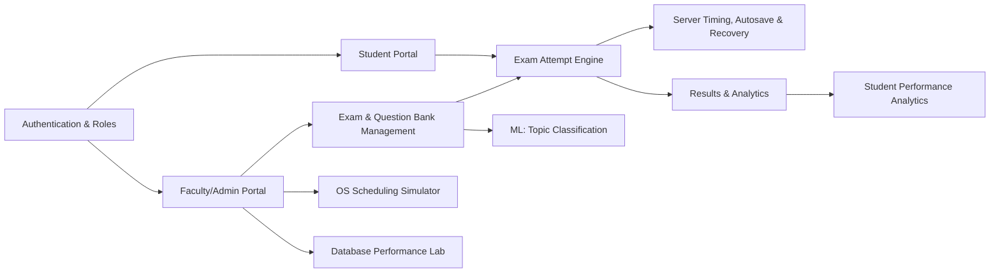
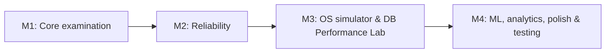
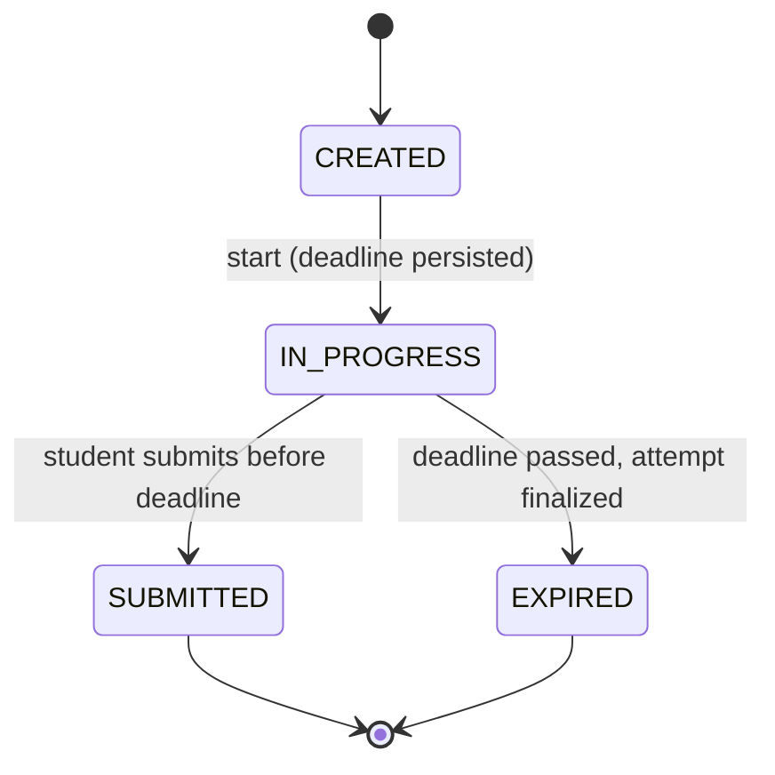
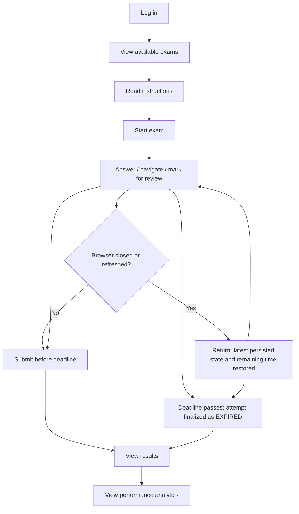
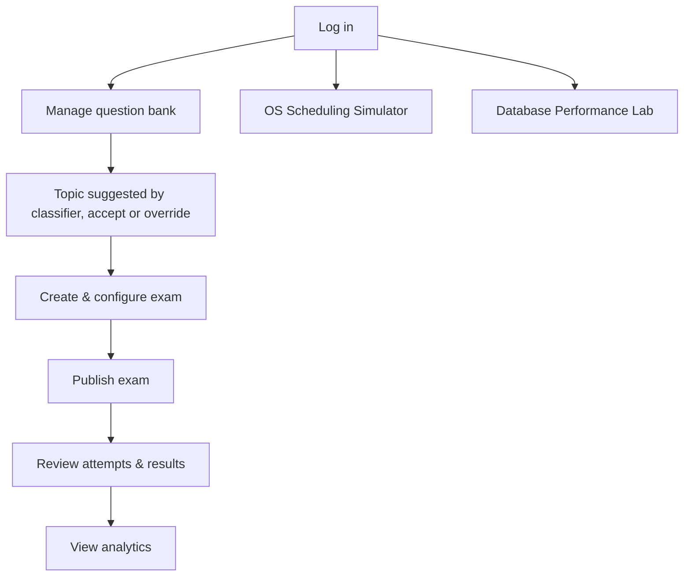
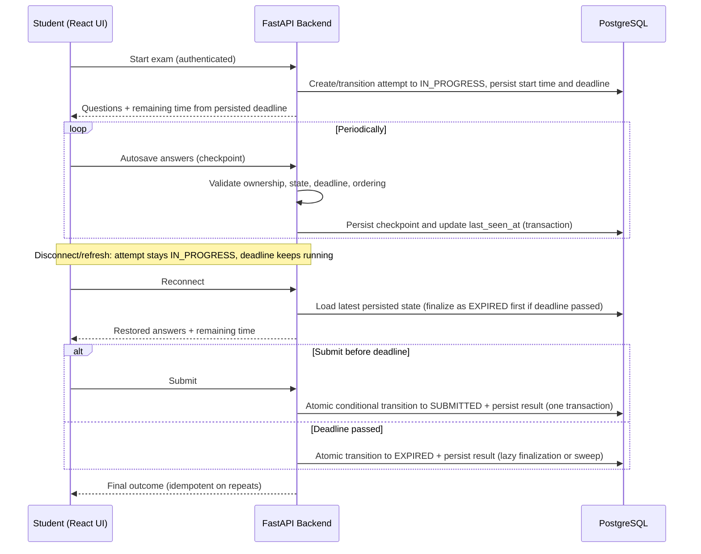

# ExamOS — Intelligent Examination & Reliability Platform

## 1. Project Title

**ExamOS — Intelligent Examination & Reliability Platform**

## 2. One-Line Project Description

A web-based examination platform that conducts MCQ examinations while demonstrating how Operating Systems and DBMS mechanisms — attempt lifecycle management, server-authoritative timing, checkpointing, transactions, indexing and concurrency control — make examination systems reliable, supported by a lightweight ML topic classifier and data-driven analytics.

---

## 3. Abstract

ExamOS is a solo-developed, B.Tech 5th-semester Project Based Learning (PBL) project combining Operating Systems, Database Management Systems, and Artificial Intelligence / Machine Learning. It provides a complete examination workflow for students and faculty — authentication, exam creation, a question bank, timed MCQ attempts, autosave, recovery, submission, results and analytics.

What distinguishes the project from a conventional online examination site is its emphasis on *reliability and observability*. Each examination attempt follows a small, durable lifecycle validated on the server. The server owns the clock: every attempt has a persisted start time and deadline, and answers arriving after the deadline are rejected. Student answers are checkpointed to PostgreSQL under transactional guarantees, so a refresh or interruption results in restoration of the latest persisted state rather than loss. Submission is finalized exactly once, together with the persisted result.

Two educational modules make the underlying concepts visible to an evaluator: an **OS Scheduling Simulator** (FCFS, Round Robin, Priority) and a **Database Performance Lab** that compares predefined benchmark queries on seeded datasets using real PostgreSQL query plans and measured timings. A lightweight **question topic classifier** (TF-IDF with a scikit-learn model) assists faculty, and **student performance analytics** provide deterministic, data-driven feedback. AI/ML remains optional to the core examination workflow.

---

## 4. Problem Statement

Online examination systems are frequently built as simple CRUD applications: questions are stored, answers are posted, and a score is computed. Such systems tend to fail when reliability matters most:

- A page refresh, network drop or browser crash can lose answers or invalidate an attempt.
- Time limits enforced only on the client can be bypassed or can drift.
- Concurrent writes (repeated autosaves, duplicate submissions, multiple tabs) can corrupt or overwrite data if not handled deliberately.
- Attempts abandoned by closing the browser may never be finalized unless the system defines how that happens.
- Query performance can degrade as attempt and response data grows, and the cause is rarely visible to the people operating the system.
- Faculty receive scores but little organized insight about question topics and student weaknesses.

From an academic standpoint, students typically study OS and DBMS concepts in isolation, with few opportunities to see them applied together in one working system.

---

## 5. Proposed Solution

ExamOS addresses these problems with an architecture shaped by OS and DBMS principles:

1. **Small durable attempt lifecycle.** Each attempt moves through a minimal set of persisted states with server-validated transitions. Temporary client connectivity is tracked separately and is not a lifecycle state.
2. **Server-authoritative timing.** The start time and deadline are persisted per attempt; remaining time is always derived from the server's deadline.
3. **Checkpointing and recovery.** Answers are persisted periodically; recovery restores the latest persisted state.
4. **Safe, exactly-once finalization.** Submission and expiry both finalize an attempt at most once, with the result persisted consistently.
5. **Transactional, constraint-enforced persistence** in a normalized PostgreSQL schema.
6. **Educational labs** — a scheduling simulator and a database performance lab with a controlled, reproducible methodology.
7. **Lightweight, optional ML and analytics** that assist faculty and students without gating the core workflow.

---

## 6. Project Vision

> A reliable examination platform that not only conducts examinations but also demonstrates the OS and DBMS mechanisms required to manage examination sessions, recover from interruptions, safely persist responses, handle concurrent activity, and analyze database performance.

The intent is a system whose *design decisions can be explained and defended* in terms of core computer science concepts, rather than a feature-heavy product.

---

## 7. Project Objectives

| # | Objective | Subject area |
|---|-----------|--------------|
| O1 | Deliver an end-to-end MCQ examination workflow for students and faculty. | General |
| O2 | Model examination attempts with a minimal durable lifecycle and server-validated transitions. | OS |
| O3 | Enforce server-authoritative timing based on a persisted deadline. | OS / DBMS |
| O4 | Implement autosave and recovery that restore the latest persisted attempt state. | OS / DBMS |
| O5 | Guarantee exactly-once finalization and protection against duplicate or stale requests. | DBMS |
| O6 | Provide an educational scheduling simulator with standard metrics and Gantt-style visualization. | OS |
| O7 | Design a normalized relational schema with integrity constraints and transactional guarantees. | DBMS |
| O8 | Provide a database performance lab with reproducible, measured query comparisons. | DBMS |
| O9 | Provide a lightweight, evaluated ML topic classifier with faculty override and fallback. | AI/ML |
| O10 | Provide data-driven student performance analytics. | Analytics |
| O11 | Keep the system secure, testable and demonstrable within a 2–4 week solo timeline. | Engineering |

---

## 8. Target Users

| User | Description | Primary needs |
|------|-------------|---------------|
| **Student** | Examinee taking MCQ-based assessments. | Reliable exam experience, no answer loss, clear results and feedback. |
| **Faculty / Admin** | Creates and manages exams and questions and reviews outcomes. | Easy exam setup, question bank management, results, analytics, access to the labs. |
| **Evaluator (academic)** | Assesses the project for PBL. | Visible, demonstrable OS/DBMS/ML concepts and defensible design. |

---

## 9. Core Modules

| Module | Summary |
|--------|---------|
| Authentication & Authorization | Login, JWT-based sessions, role-based access (student vs. faculty/admin). |
| Student Portal | Exam listing, instructions, attempt interface, review marking, results, performance view. |
| Faculty/Admin Portal | Exam creation and configuration, publish/unpublish, attempt and result review, analytics. |
| Question Bank | Creation, topic assignment and reuse of MCQ questions. |
| Exam Attempt Engine | Durable attempt lifecycle, persisted deadline, server-side timing, validated transitions. |
| Autosave & Recovery | Periodic answer checkpoints, validation, and restoration of the latest persisted state. |
| Results & Analytics | Scoring, question-level and topic-level analysis. |
| OS Scheduling Simulator | Standalone educational simulation of scheduling algorithms. |
| Database Performance Lab | Controlled comparison of benchmark queries with and without indexes. |
| ML Topic Classification | Suggests a configured topic for new questions; faculty can override. |

---

## 10. Implementation Plan and Milestones

The project is developed by one student in approximately 2–4 weeks. The scope and differentiating features are retained, but delivery is divided into milestones so that a working system exists early.

| Milestone | Focus | Deliverables |
|-----------|-------|--------------|
| **1 — Core examination** | A working end-to-end exam | Authentication and role-based access; faculty creates an examination and manages MCQs; student starts an examination, answers questions, submits, and receives a result. |
| **2 — Reliability** | The mechanisms that distinguish ExamOS | Server-authoritative timing; autosave and recovery; safe submission and protection against duplicate or stale requests. |
| **3 — Academic demonstration modules** | OS and DBMS demonstrations | OS scheduling simulator with FCFS, Round Robin and Priority Scheduling; Database Performance Lab with reproducible indexed/non-indexed query comparisons. |
| **4 — ML and refinement** | Lightweight ML, analytics, polish | One lightweight ML-based question-topic classifier; student performance analytics; additional polish and testing. |

Implementation order may overlap where appropriate (for example, the standalone scheduling simulator does not depend on the examination engine). However, **a working core examination system takes priority over advanced features**. Neither the OS simulator nor the Database Performance Lab is removed from the intended project; they are sequenced, not dropped.

---

## 11. OS Integration

OS concepts are applied in two ways: as *design inspiration* for the examination attempt engine, and as an *explicit simulation* in the scheduling simulator. The two are kept separate.

> **Important distinction.** An examination session in ExamOS is an **application-level construct**. It is *not* an operating-system process, and the project does not claim that browser sessions map to kernel processes. OS concepts are used as analogies and design models.

### 11.1 Examination Attempt Lifecycle

The durable lifecycle is intentionally small. Additional states are introduced only if they represent a necessary, well-defined business condition.

| State | Meaning |
|-------|---------|
| `CREATED` | The attempt record exists but the timer has not started. (If the design starts the timer at creation, this state may be collapsed during architecture design.) |
| `IN_PROGRESS` | The attempt has a persisted start time and deadline and accepts answer updates until the deadline. |
| `SUBMITTED` | The student finalized the attempt before the deadline; the result is persisted. Terminal. |
| `EXPIRED` | The deadline passed before submission; the attempt was finalized by the system using the answers persisted so far, and the result is persisted. Terminal. |

Principles:

- **Every durable state transition is validated on the server.** Clients may request an action (start, save, submit) but never set a state.
- **Disconnection is not a lifecycle state.** A browser disconnect does not prove the attempt has changed state: the student may reconnect, and the deadline continues to run regardless. Connectivity and activity are tracked separately, for example through a `last_seen_at` value updated by requests (and usable by faculty monitoring in the optional scope).
- **Recovery is an operation, not a state.** When a student returns, the system loads the latest persisted attempt state (answers, marks for review, position if stored) and the remaining time computed from the persisted deadline. The attempt remains `IN_PROGRESS` throughout; no permanent "recovering" state is needed.
- Terminal states are immutable.

### 11.2 OS Concept Mapping

| Concept | OS analogy | ExamOS application |
|---------|------------|--------------------|
| Process state model | New / Ready / Running / Terminated | A minimal attempt lifecycle with validated transitions (an analogy, not an equivalence). |
| Checkpoint/restart | Checkpointing | Periodic persistence of answers; restoration of the latest checkpoint on return. |
| Timer / timeout | Timer interrupt | A persisted deadline; expired attempts are finalized by defined mechanisms (Section 12.3). |
| Atomic state change | Synchronization / mutual exclusion | Exactly-once finalization under concurrent or duplicate requests. |

### 11.3 Autosave and Checkpointing

- Periodic persistence of student answers during an attempt.
- Restoration of the latest persisted state after refresh or interruption.
- Server-side validation of every checkpoint: attempt ownership, current state, deadline, and request ordering.
- Rejection of invalid or stale updates (for example, updates to a finalized attempt, updates after the deadline, or older updates arriving after newer ones).

### 11.4 Examination Scheduling Simulator

A separate, explicitly educational module implementing:

- **FCFS** (First-Come, First-Served)
- **Round Robin** (configurable time quantum)
- **Priority Scheduling**

Computed metrics: waiting time, turnaround time, response time, completion time, and CPU utilization where meaningful. Results are shown in tabular form and as a Gantt-chart-style visualization.

The simulator operates on user-defined or scenario-based inputs (for example, abstract jobs described by arrival time, burst time and priority). It is a **simulation**. It does not represent real kernel-level scheduling, and it does not schedule real examination attempts, browser sessions or OS processes. It is independent of the actual examination system.

---

## 12. Timing, Expiry and Safe Submission

This section states the architectural requirements. Detailed design belongs in later documents.

### 12.1 Timing principles

- **Authoritative start time and deadline are persisted** for every attempt when it starts. The deadline is derived from the start time and the exam's configured duration (and any exam closing time, if defined later).
- **Remaining time is calculated from the server's persisted deadline.** The client timer is a display convenience and is re-synchronized from server responses; client clocks are never trusted.
- **Answer updates arriving after the deadline are rejected.**
- Timing does not depend on whether the browser is connected.

### 12.2 Exactly-once finalization

- An attempt is finalized **only once**, even if duplicate or concurrent submission requests (double-click, retry, multiple tabs, or a submit racing with expiry) occur.
- The architectural approach is a database-level guarantee: the transition out of `IN_PROGRESS` is performed as an atomic, conditional operation inside a transaction (for example, a conditional update or row-level lock), so exactly one request succeeds and others observe the already-final state.
- The **final result is calculated and persisted in the same transaction** as the state transition, so a finalized attempt never exists without a consistent result.
- Repeated finalization requests return the existing outcome and do not re-score or alter it (idempotent behaviour).

### 12.3 Finalizing expired attempts when the student disappears

If a student closes the browser or sends no further requests, the deadline still passes. The system does not rely on the client to finalize the attempt. The proposed mechanisms, designed for a single-developer, single-backend deployment, are:

1. **Lazy finalization on access (correctness guarantee).** Whenever any server operation reads or writes an attempt — including a student's reconnect, a faculty member listing attempts, or results and analytics queries — an `IN_PROGRESS` attempt whose deadline has passed is first finalized as `EXPIRED` through the same exactly-once procedure, scored from the answers persisted before the deadline. Reports and results therefore never show overdue attempts as still in progress.
2. **Optional in-process periodic sweep (convenience).** A lightweight periodic task inside the FastAPI backend (or a manually run maintenance command) may finalize overdue attempts sooner. Because an in-process task does not survive application restarts, it is **not** relied upon for correctness; lazy finalization remains the guarantee.

The project does **not** introduce a distributed job queue, a separate worker service, or additional infrastructure for this purpose, and it does not claim guaranteed real-time background auto-submission beyond the mechanisms above. Consequently, the *stored* state of an abandoned attempt may briefly remain `IN_PROGRESS` after its deadline until the next access or sweep, but its externally visible status and score are always computed consistently.

---

## 13. DBMS Integration

The relational database is a first-class component of the system rather than a passive store.

| Concept | Role in ExamOS |
|---------|----------------|
| Relational data modelling | Entities for users, exams, questions, attempts and responses with clear relationships. |
| Normalization | Schema normalized to avoid redundancy; denormalization only with a justified performance reason. |
| Primary / foreign keys | Identity and referential integrity across all entities. |
| UNIQUE, NOT NULL, CHECK constraints | Data validity enforced by the database, not only the application. |
| Transactions (ACID) | Atomic checkpointing, finalization and scoring. |
| Concurrency considerations | Safe handling of duplicate submissions, overlapping autosaves and multi-tab behaviour. |
| Indexes | Supporting common access paths (e.g. attempt and response lookups). |
| Joins and aggregation | Results, analytics and reporting queries. |
| Query optimization | Observed and explained via the Database Performance Lab. |

Detailed table definitions, constraints and indexing choices are deferred to the database-design document.

### 13.1 Database Performance Lab

A dedicated educational module that lets a faculty evaluator observe database performance behaviour. It is intended to demonstrate:

- Query execution **without** an index vs. **with** an index.
- Query execution plans and how to read them.
- JOIN performance.
- Aggregation/query performance.
- Differences in behaviour as dataset size increases.

**Methodology**

- The lab uses **predefined, safe benchmark queries** and **generated or seeded datasets** at several sizes, created reproducibly (for example, using a fixed random seed).
- It compares **actual query plans and measured execution timings**, using PostgreSQL tools such as `EXPLAIN` and `EXPLAIN ANALYZE` where appropriate.
- Indexed and non-indexed variants are compared on the same data under the same conditions, with repeated runs where appropriate.

**Safety constraints**

- Potentially destructive or unrestricted SQL execution is **not** exposed through the ordinary application UI. Users select from approved benchmark scenarios; they do not submit arbitrary SQL.
- Benchmark operations are limited to **controlled lab datasets** (kept separate from live examination data) and **approved queries**.
- Access to the lab is restricted to the faculty/admin role.

**Qualifications that will be stated alongside results**

- Measurements depend on dataset size, query shape, hardware, cache state, and PostgreSQL's query planner.
- An index does not guarantee faster execution in every case; for small tables or queries returning a large fraction of rows, the planner may reasonably choose a sequential scan.
- Results must be measured on the implemented system and must never be fabricated. This brief contains no benchmark values.

---

## 14. AI/ML and Analytics

AI/ML in ExamOS is deliberately small, useful and optional. **AI must never be required to start or complete an examination**, and no general-purpose chatbot is included.

### 14.1 Question Topic Classification (first ML feature)

When faculty create a question, the model **suggests a topic/category** from a configured topic list (for example, topics within Operating Systems and DBMS). Faculty can always **accept or override** the suggestion.

**Proposed implementation** (a proposal whose quality must be evaluated, not an existing result):

| Aspect | Proposal |
|--------|----------|
| Text features | TF-IDF over question text (and options where useful) |
| Classifier | A scikit-learn model such as Logistic Regression |
| Training data | A small, labelled, curated dataset spanning the project's OS and DBMS topics |
| Evaluation | A held-out test set with appropriate classification metrics (e.g. accuracy, per-class precision/recall/F1, confusion matrix) |
| Confidence handling | The suggestion is shown only when model confidence is sufficient |
| Fallback | If the model is unavailable or confidence is insufficient, no suggestion is made and the faculty member selects the topic manually |

Limitations to be documented: with a small curated dataset the model's quality is limited and must be measured; it will only distinguish topics represented in its training data; no accuracy figure is claimed in this brief, and none should be reported until the model has actually been trained and evaluated.

### 14.2 Student Performance Analytics (not machine learning)

After an examination, the system presents data-driven insights, such as:

- Overall accuracy and question-level performance.
- Topic-level performance, with strongest and weakest topics (using the question topics assigned above).
- Suggested areas for revision based on weaker topics.

These are **deterministic statistics and aggregations**, and are described as analytics, not as machine learning. LLM-generated explanations may be considered later only if they provide clear additional value without threatening delivery.

### 14.3 Question Difficulty Estimation (optional future enhancement)

Difficulty estimation (Easy / Medium / Hard) is moved out of the initial scope. Text alone does not reliably establish how difficult a question is. A dependable approach should use **observed question performance** — such as response accuracy once a sufficient number of attempts has accumulated — possibly combined with text features. It is therefore proposed as a future enhancement once real attempt data exists, with faculty override retained.

---

## 15. Key Differentiating Features

1. **Minimal, server-validated attempt lifecycle** that separates durable state from client connectivity.
2. **Server-authoritative timing** using a persisted deadline, with defined handling of expired attempts.
3. **Checkpoint-based autosave and recovery** designed around transactional persistence.
4. **Exactly-once finalization** with result persisted consistently, resistant to duplicate and stale requests.
5. **OS Scheduling Simulator** with standard metrics and Gantt visualization.
6. **Database Performance Lab** with a controlled, reproducible, measured methodology.
7. **Constraint-driven data integrity** enforced in PostgreSQL itself.
8. **Optional lightweight ML** (topic classification with override and fallback) and deterministic analytics.

---

## 16. High-Level User Workflow

### Student

### Faculty / Admin

---

## 17. High-Level System Workflow

---

## 18. Scope — Must-Have

- Authentication with role-based authorization
- Student portal
- Faculty/admin portal
- Examination creation and configuration
- Question bank
- MCQ examination flow (navigation, mark for review)
- Server-authoritative timing using a persisted deadline
- Autosave
- Recovery (restoration of the latest persisted state)
- Safe, exactly-once submission and finalization of expired attempts
- Results
- Relational PostgreSQL database with transactions and indexing
- Database Performance Lab (predefined queries, seeded datasets, measured results)
- OS Scheduling Simulator
- One lightweight ML capability: question topic classification, with override and fallback
- Student performance analytics (deterministic)

Delivery order follows the milestones in Section 10.

---

## 19. Scope — Optional / Future

- Question difficulty estimation based on observed performance
- Advanced analytics
- Real-time examination monitoring (e.g. using `last_seen_at`)
- LLM-generated explanations
- Question recommendations
- Deployment
- Additional AI capabilities
- UI themes and advanced animations

Optional items are pursued only after all must-have items are working and demonstrable.

---

## 20. Explicitly Out of Scope (Initial Version)

- Full LMS functionality
- Video proctoring
- Face recognition
- Webcam surveillance
- Mobile application
- Payment functionality
- Microservice architecture
- Kubernetes
- Distributed databases
- Distributed job queues and separate worker services (e.g. Redis, Celery) unless a clear requirement later justifies them
- Complex real-time infrastructure
- Large conversational chatbot
- Arbitrary SQL execution through the application UI

---

## 21. Proposed Technology Stack

These are proposed technologies, not immutable requirements. Later architecture documentation may refine them where a technically justified alternative is better.

| Layer | Proposed technology |
|-------|--------------------|
| Frontend | React, TypeScript, Tailwind CSS |
| Visualization | Recharts (or an equivalent lightweight charting solution) |
| Backend | Python, FastAPI, Pydantic |
| Database | PostgreSQL |
| ORM / DB access | SQLAlchemy |
| Migrations | Alembic |
| Authentication | JWT, role-based authorization |
| ML | Python, scikit-learn (TF-IDF, Logistic Regression) |
| Testing | Pytest (backend) |
| Development | Git/GitHub; Docker/Docker Compose where useful |

No additional infrastructure (such as Redis, Celery, Kubernetes or a microservice split) is proposed.

---

## 22. Academic Relevance

| Subject | Concepts demonstrated |
|---------|----------------------|
| **Operating Systems** | Process-state modelling (as analogy), checkpoint/restart concepts, timer/timeout handling, atomic state transitions and mutual exclusion concerns, CPU scheduling algorithms (FCFS, Round Robin, Priority) and their metrics. |
| **DBMS** | ER/relational modelling, normalization, integrity constraints, ACID transactions, concurrency control, indexing, joins, aggregation, query plans (`EXPLAIN` / `EXPLAIN ANALYZE`) and optimization. |
| **AI/ML** | Text feature extraction (TF-IDF), supervised classification, train/test evaluation with appropriate metrics, confidence thresholds and fallback behaviour, and awareness of model limitations. |

The project integrates these subjects into one coherent system rather than treating them as separate assignments.

---

## 23. Expected Demonstration Scenarios

| # | Scenario | What it demonstrates |
|---|----------|---------------------|
| D1 | Faculty creates an exam and MCQs; a student starts, answers, submits, and views the result. | Complete core workflow (Milestone 1). |
| D2 | Student refreshes or closes the browser mid-exam and returns; answers and remaining time are restored while the attempt stays `IN_PROGRESS`. | Autosave, recovery as an operation, server timing. |
| D3 | Deadline passes while the student is disconnected; the attempt is finalized as `EXPIRED` on next access (or sweep) using persisted answers. | Persisted deadline, defined expiry finalization. |
| D4 | An answer update is sent after the deadline and is rejected. | Server-side deadline enforcement. |
| D5 | Duplicate or concurrent submit requests (including submit racing with expiry) are sent; only one finalization occurs and the result is unchanged. | Exactly-once finalization, transactional safety. |
| D6 | A stale (out-of-order) autosave is sent and is rejected. | Stale-update protection. |
| D7 | Faculty runs FCFS, Round Robin and Priority on the same job set and compares metrics and Gantt charts. | OS scheduling concepts (simulation). |
| D8 | Faculty runs an approved benchmark query on seeded datasets of different sizes with and without an index and inspects the plans and measured timings, including a case where the index does not help. | Indexing, query plans, honest methodology. |
| D9 | Faculty creates a question, receives a topic suggestion, overrides it, and the system works with manual selection when the model is unavailable. | ML assistance with human control and fallback. |
| D10 | Student views topic-level strengths and weaknesses after an exam. | Deterministic performance analytics. |

---

## 24. Success Criteria

The project is considered successful if:

1. A student can complete the full workflow (login → attempt → submit → results) without defects in normal use.
2. An interrupted attempt is recovered with previously checkpointed answers intact and remaining time correctly derived from the persisted deadline.
3. Answer updates after the deadline are rejected, and abandoned attempts are finalized as `EXPIRED` through the documented mechanisms.
4. Duplicate, concurrent or stale requests cannot cause an attempt to be finalized twice or its result to change after finalization.
5. The database enforces integrity through keys and constraints, and critical operations run in transactions.
6. The scheduling simulator produces correct metrics, verified against hand-computed examples.
7. The Database Performance Lab reproducibly reports real query plans and measured timings on seeded datasets, with the stated qualifications, using only approved queries.
8. The topic classifier is trained on a curated dataset and evaluated on a held-out test set with reported metrics; faculty override and the fallback behaviour work.
9. The core examination workflow functions when ML features are disabled.
10. Backend behaviour for critical logic (state transitions, deadline enforcement, finalization) is covered by automated tests.
11. All demonstration scenarios in Section 23 can be shown live.

---

## 25. Major Technical Risks

| ID | Risk |
|----|------|
| R1 | Scope creep, given the number of modules and a 2–4 week solo timeline. |
| R2 | Race conditions or inconsistent state in autosave, recovery and finalization (including submit racing with expiry). |
| R3 | Client/server clock differences leading to incorrect timing. |
| R4 | Abandoned attempts left unfinalized, producing inconsistent reports. |
| R5 | Insufficient or poorly balanced labelled data for the topic classifier, leading to weak or misleading suggestions. |
| R6 | Database Performance Lab results being unconvincing or misinterpreted at small data volumes, or an index not helping for some queries. |
| R7 | Misrepresenting simulated OS behaviour as real OS behaviour. |
| R8 | Security weaknesses (authentication, authorization, answer exposure, unsafe lab operations). |
| R9 | Integration complexity across React, FastAPI, PostgreSQL and ML components. |

---

## 26. Risk Mitigation Strategy

| Risk | Mitigation |
|------|-----------|
| R1 | Milestone-based delivery; working core first; optional items deferred until the core is stable. |
| R2 | Minimal state model; atomic conditional transitions inside transactions; ordering checks on checkpoints; targeted tests for concurrent and duplicate requests. |
| R3 | Server is the single source of truth for time via the persisted deadline; the client only displays server-derived remaining time. |
| R4 | Lazy finalization on every access to an attempt as the correctness guarantee; optional in-process sweep for promptness; no claim of guaranteed background auto-submission. |
| R5 | Curate a modest, balanced dataset; evaluate on a held-out test set; apply a confidence threshold with manual fallback; document limitations honestly. |
| R6 | Seed datasets at several sizes; document methodology, repeat runs, and state the qualifications; report only measured results and include cases where the planner does not use the index. |
| R7 | Clear labelling of the simulator as educational; consistent "application-level session/attempt" terminology throughout all documents. |
| R8 | Server-side authorization on protected operations; hashed credentials; avoid sending correct answers to the client during an attempt; approved-query-only, role-restricted lab on separate lab data. |
| R9 | Keep architecture simple (single backend, single database); use Docker Compose for a reproducible environment; integrate incrementally following the milestones. |

---

## 27. Future Expansion Possibilities

- Question difficulty estimation using observed response accuracy once sufficient attempt data exists.
- Additional question types (multiple-select, short answer) beyond MCQ.
- Real-time faculty monitoring of active attempts using connectivity/activity information.
- LLM-generated explanations and feedback, if they demonstrably add value.
- Question recommendation based on student weaknesses.
- Cloud deployment and operational monitoring; a dedicated background worker only if a clear requirement later justifies it.
- Extended simulator coverage (e.g. preemptive priority, multilevel queues) and additional OS-concept labs.
- Extended database lab (e.g. different index types, partitioning, isolation-level demonstrations).

---

## Why This Is More Than a CRUD Examination System

A conventional examination site stores questions, accepts answers and computes a score. ExamOS differs because each subject area is demonstrated through specific mechanisms rather than mentioned in passing:

**Operating Systems**
- Attempts follow a minimal, server-validated lifecycle inspired by process-state models, with the application-level nature of sessions stated openly and connectivity kept separate from durable state.
- Checkpointing and recovery apply checkpoint/restart ideas to a real reliability problem.
- Deadlines are enforced by the server, and expired attempts are finalized by defined mechanisms.
- Exactly-once finalization addresses the same class of problem as mutual exclusion and atomic operations.
- A dedicated simulator implements FCFS, Round Robin and Priority scheduling with the standard metrics, clearly labelled as a simulation.

**DBMS**
- The schema is designed around normalization, keys and constraints, so the database itself protects validity.
- Transactions guarantee atomic checkpointing, finalization and result persistence; concurrency issues are design requirements.
- The Database Performance Lab lets an evaluator observe real query plans and measured timings on controlled datasets, including the limits of indexing.

**AI/ML**
- Topic classification is a small supervised-learning pipeline (TF-IDF features, a scikit-learn classifier, held-out evaluation, confidence threshold, manual fallback) that supports faculty and never gates the exam flow. Performance analytics are honestly presented as deterministic statistics.

Taken together, the platform is a system in which the *design decisions* — not just the features — are the demonstration.

---

**Document Status:** Draft — Project Foundation

## Next Document

**Next Document:** `01_REQUIREMENTS.md`