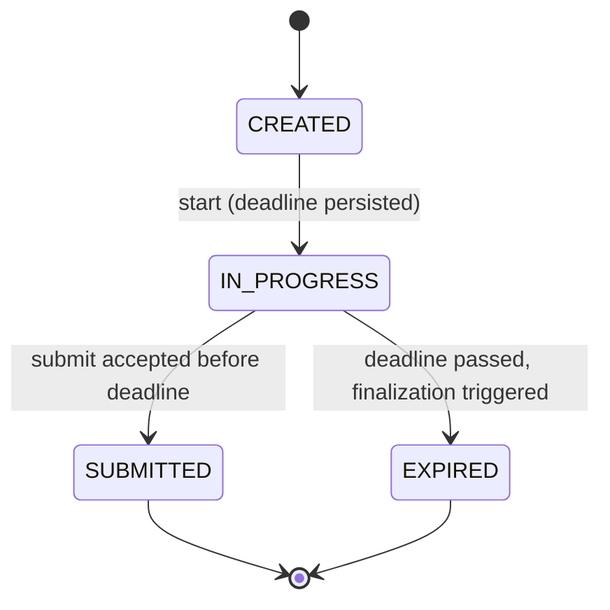

# ExamOS — Software Requirements Specification

## 1. Document Information

| Item | Value |
|------|-------|
| **Document title** | ExamOS — Software Requirements Specification (`01_REQUIREMENTS.md`) |
| **Project name** | ExamOS — Intelligent Examination & Reliability Platform |
| **Version** | 0.1 |
| **Status** | Draft — Requirements Specification |
| **Source document** | `00_PROJECT_BRIEF.md` (revised, status: Draft — Project Foundation) |
| **Intended audience** | The developer (implementation and testing), the faculty evaluator (academic review), and the authors of later documents (`02_SYSTEM_ARCHITECTURE.md` onward) |

### 1.1 Purpose

This document converts the approved project brief into numbered, testable requirements. It defines *what* ExamOS shall do and the properties it shall have. It deliberately does not define *how* (system architecture, database schema, API contract, class design and source code belong to later documents).

### 1.2 Scope of this specification

The specification covers the examination workflow, the attempt lifecycle and reliability mechanisms, the OS Scheduling Simulator, the Database Performance Lab, the ML question topic classifier, and deterministic performance analytics. Where the brief does not settle a decision that affects implementation, the decision is recorded in Section 11 as an **open decision** (`OD-xx`) rather than silently assumed.

### 1.3 Conventions

**Normative language.** "Shall" denotes a mandatory statement. "Should" denotes a recommended statement that may be deferred without failing the milestone. "May" denotes an option.

**Priority.**

| Value | Meaning |
|-------|---------|
| Must-have | Required for the intended project; part of the brief's must-have scope. |
| Should-have | Valuable and planned, but may be deferred if time is short without invalidating the project. |
| Future | Not part of the initial implementation; recorded to prevent scope confusion. |

**Milestones** follow `00_PROJECT_BRIEF.md`: **M1** Core examination, **M2** Reliability, **M3** Academic demonstration modules, **M4** ML and refinement. Milestones determine implementation order and may overlap; they do not remove planned features.

**Verification methods.** **T** = automated or scripted test; **I** = inspection (review of code, configuration or documents); **D** = live demonstration; **M** = measurement on a documented environment.

**Identifiers.** `FR-*` functional requirement, `NFR-*` non-functional requirement, `BR-*` business rule/invariant, `AC-*` acceptance criterion, `EC-*` edge case, `OD-*` open decision, `O1`–`O11` project objectives from the brief. Identifiers are stable and are never reused.

### 1.4 Terminology

| Term | Definition |
|------|------------|
| **Attempt** | One student's examination session for one examination. An *application-level* construct; it is not an operating-system process. |
| **Durable state** | The lifecycle state of an attempt as persisted: `CREATED`, `IN_PROGRESS`, `SUBMITTED`, `EXPIRED`. |
| **Terminal state** | `SUBMITTED` or `EXPIRED`. |
| **Finalization** | The single operation that moves an attempt from `IN_PROGRESS` to a terminal state and persists its final result. |
| **Deadline** | The persisted instant after which an attempt accepts no further answers. |
| **Acknowledged save** | A save that the server has durably persisted and has confirmed to the client. |
| **Recovery** | An operation that restores the latest persisted state of an attempt to a returning student. It is not a durable state. |
| **Connectivity information** | Optional separate data (for example a last-seen timestamp) about client activity. It is not part of the lifecycle. |
| **Lab** | Either educational module: the OS Scheduling Simulator or the Database Performance Lab. |

---

## 2. Product Scope

### 2.1 What ExamOS will provide

1. **Primary examination workflow.** Faculty create MCQ examinations and questions; students take timed examinations, answer, mark for review, submit, and receive results.
2. **Reliability mechanisms.** A minimal durable attempt lifecycle, server-authoritative timing based on a persisted deadline, autosave with recovery, protection against stale and duplicate requests, and finalization of expired attempts through lazy finalization (with an optional in-process sweep).
3. **OS educational module.** A standalone OS Scheduling Simulator (FCFS, Round Robin, Priority Scheduling), clearly labelled as a simulation.
4. **DBMS educational module.** A Database Performance Lab using predefined, approved benchmark scenarios on controlled, seeded lab datasets, with real PostgreSQL plans and measured timings.
5. **ML capability.** A lightweight question topic classifier (TF-IDF with a scikit-learn classifier) that *suggests* topics; faculty can override.
6. **Analytics.** Deterministic student performance analytics and basic examination analytics. These are statistics, not machine learning.

### 2.2 Optional nature of AI at runtime

ML is an assistive feature only. The examination workflow, question creation, and every other function shall work when the classifier is absent or fails (FR-ML-005, FR-ML-006, BR-021).

### 2.3 Explicit exclusions (initial implementation)

Full LMS functionality; video proctoring; face recognition; webcam surveillance; a mobile application; payments; microservices; Kubernetes; distributed databases; distributed job queues and separate worker services (for example Redis or Celery); arbitrary SQL execution through the application UI; a general-purpose chatbot. Further clarifications are listed in Section 10.

### 2.4 Question and scoring model (scope clarification)

Examinations contain **MCQ questions with exactly one correct option** (multiple-select and other question types are future work per the brief). Each question carries a positive mark value. Scoring awards the question's marks for a correct selection and zero otherwise; negative marking is not part of this version.

---

## 3. User Roles and Permissions

The initial application has exactly **two authorization roles**: `STUDENT` and `FACULTY_ADMIN`. No separate super-administrator role is defined. Internal system operations (finalization triggers, the optional sweep) run on behalf of the system and are not exposed as role-level actions.

### 3.1 Roles

| Role | Responsibilities |
|------|------------------|
| `STUDENT` | Takes examinations; accesses *only their own* attempts, results and performance analytics. |
| `FACULTY_ADMIN` | Manages questions and examinations; views attempts, results and analytics for examinations; uses the OS Scheduling Simulator and the Database Performance Lab; requests ML topic suggestions. |

### 3.2 Permission matrix

✓ = permitted; ✗ = denied; "own" = only for resources the user owns. Denial means the operation is rejected on the server with no data disclosed (FR-AUTH-008, FR-AUTH-009).

| Operation | Unauthenticated | `STUDENT` | `FACULTY_ADMIN` |
|-----------|:---:|:---:|:---:|
| Log in | ✓ | ✓ | ✓ |
| Create / edit examination | ✗ | ✗ | ✓ (scope: OD-09) |
| Publish / unpublish examination | ✗ | ✗ | ✓ (scope: OD-09) |
| Create / edit / list questions (question bank) | ✗ | ✗ | ✓ (scope: OD-09) |
| View correct answers of a question (authoring) | ✗ | ✗ | ✓ |
| List published examinations available to the user | ✗ | ✓ (eligibility: OD-02) | ✓ (read-only listing) |
| List all examinations including unpublished | ✗ | ✗ | ✓ |
| Start an attempt | ✗ | ✓ | ✗ |
| Save answers to an attempt | ✗ | own, `IN_PROGRESS`, before deadline | ✗ |
| Submit an attempt | ✗ | own, `IN_PROGRESS` | ✗ |
| Recover (resume) an attempt | ✗ | own | ✗ |
| Read correct answers during an `IN_PROGRESS` attempt | ✗ | ✗ | n/a (no access to student answer content) |
| View result of a finalized attempt | ✗ | own | ✓ |
| View another student's attempt or result | ✗ | ✗ | ✓ (results only; finalized attempts) |
| View attempt list (student, state, times, score) for an examination | ✗ | ✗ | ✓ |
| Modify or delete a finalized attempt, its answers or its result | ✗ | ✗ | ✗ |
| View own performance analytics | ✗ | ✓ | ✗ |
| View examination-level analytics | ✗ | ✗ | ✓ |
| Use the OS Scheduling Simulator | ✗ | ✗ | ✓ |
| Use the Database Performance Lab | ✗ | ✗ | ✓ |
| Request ML topic suggestion | ✗ | ✗ | ✓ |

### 3.3 Required authorization behaviour

- **Own-attempt access.** A student can read and modify only attempts they started (FR-ATTEMPT-007, BR-001).
- **Isolation between students.** One student shall never read another student's private attempt data, answers or results (BR-001, FR-RESULT-006, AC-13).
- **Faculty access.** Faculty can manage examinations and view finalized results and analytics; they cannot act as a student or alter student answers.
- **Lab access.** Both labs are restricted to `FACULTY_ADMIN` (FR-OSLAB-001, FR-DBLAB-001).
- **Finalized attempts are protected.** No role may change a finalized attempt (BR-007).
- **Answer key protection.** Correct answers are never delivered to a student before that student's attempt is finalized (BR-016, FR-STUD-012, AC-14).
- **Independence from mechanism.** These behaviours are required irrespective of how identity is conveyed between client and server.

---

## 4. Functional Requirements

Each requirement table uses the columns: **ID**, **Requirement**, **Priority**, **Milestone**, **Verification**. "Must" in the Priority column means Must-have.

### 4.1 Authentication and Authorization

| ID | Requirement | Priority | Milestone | Verification |
|----|-------------|----------|-----------|--------------|
| FR-AUTH-001 | The system shall authenticate a user from submitted credentials and, on success, establish an authenticated identity usable for subsequent protected requests. | Must | M1 | T |
| FR-AUTH-002 | The system shall reject invalid credentials with a generic error that does not reveal whether the account identifier exists. | Must | M1 | T |
| FR-AUTH-003 | The system shall provide a logout action that discards the client's authenticated identity. Server-side revocation is not required; credentials remain bounded by FR-AUTH-005. | Must | M1 | T, D |
| FR-AUTH-004 | The system shall store passwords only as salted, computationally slow one-way hashes produced by an established password-hashing algorithm. Plaintext passwords and hashes shall never be returned in responses or written to logs. | Must | M1 | I, T |
| FR-AUTH-005 | Authenticated identities shall have a bounded lifetime; requests presenting an expired identity shall be rejected as unauthenticated. | Must | M1 | T |
| FR-AUTH-006 | Every operation other than login shall require valid authentication; unauthenticated requests shall be rejected and shall return no protected data. | Must | M1 | T |
| FR-AUTH-007 | Every account shall have exactly one role, `STUDENT` or `FACULTY_ADMIN`. | Must | M1 | T, I |
| FR-AUTH-008 | The server shall enforce the permission matrix (Section 3.2) on every protected operation. Hiding controls in the user interface shall not be the only enforcement. | Must | M1 | T |
| FR-AUTH-009 | A request by an authenticated user that is not permitted shall be rejected with an authorization error distinct from the unauthenticated error and shall disclose no content of the protected resource. Whether a non-owned resource is reported as "forbidden" or "not found" is an architecture decision. | Must | M1 | T |
| FR-AUTH-010 | The system shall provide a means of creating `STUDENT` and `FACULTY_ADMIN` accounts sufficient to run all demonstration scenarios (mechanism: OD-01). | Must | M1 | D |
| FR-AUTH-011 | After login the user shall be presented with the portal appropriate to their role and shall not be offered functions their role cannot perform. | Should | M1 | D |

Social login, multi-factor authentication and password-reset flows are not required.

### 4.2 Faculty Examination Management

| ID | Requirement | Priority | Milestone | Verification |
|----|-------------|----------|-----------|--------------|
| FR-EXAM-001 | A faculty user shall be able to create an examination with a title, instructions text and a duration in whole minutes. | Must | M1 | T, D |
| FR-EXAM-002 | The system shall validate examination input: the title shall be non-empty; the duration shall be a positive integer not exceeding a configured maximum; invalid input shall be rejected with a descriptive error. | Must | M1 | T |
| FR-EXAM-003 | A faculty user shall be able to edit an examination's title, instructions, duration and question set while it is unpublished. Editing rules for examinations that have attempts are governed by OD-08. | Must | M1 | T |
| FR-EXAM-004 | A faculty user shall be able to attach questions from the question bank to an examination and define their order. | Must | M1 | T, D |
| FR-EXAM-005 | The system shall allow an examination to be published only if it contains at least one question and every attached question is valid per FR-QUESTION-001 to FR-QUESTION-003. | Must | M1 | T |
| FR-EXAM-006 | A faculty user shall be able to unpublish an examination. Unpublishing shall prevent new attempts from starting; its effect on existing attempts is governed by OD-08. | Must | M1 | T |
| FR-EXAM-007 | A faculty user shall be able to list examinations with their title, duration, publication status and question count. | Must | M1 | T, D |
| FR-EXAM-008 | Later edits to an examination or its questions shall not change the score, outcome or stored answers of any already-finalized attempt. | Must | M2 | T |
| FR-EXAM-009 | The total marks of an examination shall equal the sum of the marks of its attached questions and shall be shown to faculty and students. | Must | M1 | T |
| FR-EXAM-010 | Whether examinations have explicit opening and closing times is an open decision (OD-02). Until resolved, the attempt deadline is defined only by FR-TIME-001. | Must | M1 | I |

### 4.3 Question Bank

| ID | Requirement | Priority | Milestone | Verification |
|----|-------------|----------|-----------|--------------|
| FR-QUESTION-001 | A faculty user shall be able to create an MCQ question consisting of question text and at least two and at most a configured maximum number of options, each with non-empty text. | Must | M1 | T |
| FR-QUESTION-002 | A question shall have exactly one option designated correct. | Must | M1 | T |
| FR-QUESTION-003 | A question shall have a marks value that is a positive number. | Must | M1 | T |
| FR-QUESTION-004 | A faculty user shall be able to edit a question. Restrictions on editing questions already used in published examinations or attempts are governed by OD-08. | Must | M1 | T |
| FR-QUESTION-005 | A question shall be associable with at most one topic chosen from the configured topic list (OD-06). A question without a topic is permitted; it is excluded from topic-level analytics (FR-ANALYTICS-002). | Must | M1 | T |
| FR-QUESTION-006 | A faculty user shall be able to list questions in the question bank and filter them by topic. | Should | M1 | T, D |
| FR-QUESTION-007 | A question shall be reusable in more than one examination. | Must | M1 | T |
| FR-QUESTION-008 | Invalid question input shall be rejected with an error that identifies the offending field. | Must | M1 | T |
| FR-QUESTION-009 | The system shall not permit deletion of a question in a way that removes data needed to display or reproduce a finalized attempt (policy: OD-08). | Must | M2 | T |

Only MCQ questions with plain text are in scope.

### 4.4 Student Examination Workflow

| ID | Requirement | Priority | Milestone | Verification |
|----|-------------|----------|-----------|--------------|
| FR-STUD-001 | A student shall be able to view the published examinations available to them, showing title, duration and total marks (eligibility: OD-02). | Must | M1 | T, D |
| FR-STUD-002 | Before starting, a student shall be shown the examination's instructions and duration; the attempt begins only after an explicit start action. | Must | M1 | D |
| FR-STUD-003 | During an attempt the system shall display each question's text and options and allow the student to select exactly one option. | Must | M1 | D |
| FR-STUD-004 | A student shall be able to change a selected answer at any time while the attempt accepts answers. | Must | M1 | T, D |
| FR-STUD-005 | A student shall be able to navigate to any question in any order. | Must | M1 | D |
| FR-STUD-006 | A student shall be able to mark and unmark any question for review, independently of whether it is answered. | Must | M1 | T, D |
| FR-STUD-007 | The system shall display for every question whether it is unanswered, answered, and/or marked for review. | Must | M1 | D |
| FR-STUD-008 | The remaining time shall be displayed continuously during an attempt, derived from the server (FR-TIME-002, FR-TIME-003). | Must | M2 | D |
| FR-STUD-009 | The system shall display the save status of the student's changes (for example saved, saving, failed), consistent with FR-SAVE-004. | Must | M2 | D |
| FR-STUD-010 | Submission shall require explicit confirmation and shall show the number of unanswered questions before the student confirms. | Must | M1 | D |
| FR-STUD-011 | After finalization the student shall be able to access the result of their attempt (FR-RESULT-001). | Must | M1 | T, D |
| FR-STUD-012 | No payload delivered to a student before their attempt is finalized shall contain the correct option of any question or any field from which it can be derived. | Must | M1 | T |
| FR-STUD-013 | Questions shall be presented in the order defined by the examination; randomization of order or options is not provided. | Must | M1 | D |

### 4.5 Examination Attempt Lifecycle

| ID | Requirement | Priority | Milestone | Verification |
|----|-------------|----------|-----------|--------------|
| FR-ATTEMPT-001 | Every attempt shall have exactly one persisted durable state from {`CREATED`, `IN_PROGRESS`, `SUBMITTED`, `EXPIRED`}. | Must | M1 | T, I |
| FR-ATTEMPT-002 | The only valid transitions shall be `CREATED → IN_PROGRESS`, `IN_PROGRESS → SUBMITTED` and `IN_PROGRESS → EXPIRED`. Every other requested transition (including `CREATED → SUBMITTED`, `CREATED → EXPIRED`, any transition out of a terminal state, and any backward transition) shall be rejected without modifying the attempt. | Must | M1 | T |
| FR-ATTEMPT-003 | `SUBMITTED` and `EXPIRED` are terminal. After an attempt reaches a terminal state, its state, answers, review marks, outcome and result shall not change. | Must | M1 | T |
| FR-ATTEMPT-004 | An attempt shall be created only if: the requester is an authenticated `STUDENT`; the examination is published; the student is eligible (OD-02); the student has no non-terminal attempt for that examination; and the retake policy allows another attempt (OD-03). Otherwise the request shall be rejected with a descriptive error. | Must | M1 | T |
| FR-ATTEMPT-005 | Starting an attempt shall move it to `IN_PROGRESS` and persist its start time and deadline (FR-TIME-001). A repeated start request for an examination in which the student already has an `IN_PROGRESS` attempt shall return that attempt and shall not create another. | Must | M1 | T |
| FR-ATTEMPT-006 | All durable state transitions, start times, deadlines and scores shall be determined by the server. Client-supplied values for these shall be ignored or rejected. | Must | M1 | T |
| FR-ATTEMPT-007 | An attempt shall be owned by the student who started it. Only the owner may save answers to it, submit it, recover it, or read its non-finalized data. | Must | M1 | T |
| FR-ATTEMPT-008 | Client connectivity shall be represented separately from the attempt lifecycle. The system should record a last-activity timestamp updated by authenticated attempt requests. A browser disconnection shall not change the attempt's durable state and shall not pause or alter the deadline. | Should | M2 | T, I |
| FR-ATTEMPT-009 | A request that is invalid for the attempt's current state (for example a save to a finalized attempt) shall be rejected with an error that states the attempt is no longer accepting changes, and shall leave the attempt unchanged. Submit requests to a finalized attempt are handled by FR-SUBMIT-006. | Must | M1 | T |
| FR-ATTEMPT-010 | Whether `CREATED` is a separately persisted state or is merged into the start operation is an open decision (OD-10). If retained as a state, an attempt in `CREATED` shall accept no answers and shall have no deadline. | Must | M1 | I |

### 4.6 Server-Authoritative Timing

| ID | Requirement | Priority | Milestone | Verification |
|----|-------------|----------|-----------|--------------|
| FR-TIME-001 | When an attempt starts, the server shall persist its start time (from the server clock) and its deadline, equal to the start time plus the examination's duration at that moment. Later changes to the examination's duration shall not alter the deadline of an existing attempt. | Must | M2 | T |
| FR-TIME-002 | The remaining time shall be calculated by the server as the persisted deadline minus the current server time, and shall be zero when the deadline has passed. Responses carrying attempt data to the student shall include this server-calculated value (or the values from which it is derived). | Must | M2 | T |
| FR-TIME-003 | The client countdown is a display aid only. It shall be resynchronized from server responses. When the countdown reaches zero the client shall ask the server for the outcome rather than deciding locally that the attempt has ended. The client's clock shall never determine whether an answer or submission is valid. | Must | M2 | T, D |
| FR-TIME-004 | Page refresh, reconnection, re-login or recovery shall not extend, reset or otherwise alter an attempt's deadline. | Must | M2 | T |
| FR-TIME-005 | The server shall reject any answer update whose processing occurs after the deadline, judged by the server clock at the time the request is processed. No grace period is provided in this version. A request sent before the deadline but processed after it shall be rejected. | Must | M2 | T |

### 4.7 Autosave and Recovery

**Autosave**

| ID | Requirement | Priority | Milestone | Verification |
|----|-------------|----------|-----------|--------------|
| FR-SAVE-001 | The system shall persist answer changes and review-mark changes to the server automatically during an attempt, without requiring a manual save action. Trigger and cadence are defined by OD-07. | Must | M2 | T, D |
| FR-SAVE-002 | The server shall validate every save: the requester is authenticated; the requester owns the attempt; the attempt is `IN_PROGRESS`; the deadline has not passed (FR-TIME-005); the question belongs to the attempt's examination; and any selected option belongs to that question. Invalid saves shall be rejected without modifying the attempt. | Must | M2 | T |
| FR-SAVE-003 | The server shall acknowledge a save only after the change has been durably persisted. A rejected or failed save shall never be acknowledged as persisted. | Must | M2 | T |
| FR-SAVE-004 | The client shall present a change as saved only after receiving an acknowledgement for it. Otherwise it shall present the change as pending or failed, shall retain the unacknowledged change locally while the attempt is active, and shall retry. | Must | M2 | T, D |
| FR-SAVE-005 | Each save shall carry ordering information sufficient for the server to determine whether the save is older than data already accepted for the same answer. A save older than already-accepted data shall be rejected or ignored and shall never overwrite newer accepted data. (The ordering mechanism is an architecture decision.) | Must | M2 | T |
| FR-SAVE-006 | When a save and a submission or expiry for the same attempt are processed concurrently, the outcome shall be equivalent to some single serial order: either the save is persisted before finalization and is counted in scoring, or it is rejected because finalization occurred first. No partially applied state shall result. | Must | M2 | T |
| FR-SAVE-007 | Repeating an identical save request shall leave the persisted state unchanged. | Must | M2 | T |
| FR-SAVE-008 | When two browser tabs edit the same attempt, the server shall apply the ordering rule of FR-SAVE-005, the persisted data shall remain consistent and valid, and a client whose save is rejected shall reload the persisted state. | Should | M2 | T |
| FR-SAVE-009 | Scoring shall use only answers that were persisted by the server. Before submission, the client shall warn the student if unacknowledged changes exist. | Must | M2 | T, D |
| FR-SAVE-010 | If persistence is unavailable (for example the database is unreachable), the save shall fail with an error, shall not be acknowledged, and shall not change the attempt's state. | Must | M2 | T |

**Recovery**

| ID | Requirement | Priority | Milestone | Verification |
|----|-------------|----------|-----------|--------------|
| FR-RECOVERY-001 | When a student returns to their `IN_PROGRESS` attempt (after refresh, new tab, or re-login) the system shall restore the latest persisted answers and review marks. | Must | M2 | T, D |
| FR-RECOVERY-002 | The system should persist the student's current question position on a best-effort basis and, when it is persisted, restore it on recovery; otherwise recovery shall begin at the first question. | Should | M2 | D |
| FR-RECOVERY-003 | Recovery shall present the remaining time computed from the persisted deadline (FR-TIME-004). | Must | M2 | T |
| FR-RECOVERY-004 | Recovery shall be a read of persisted state and shall not require, or create, a distinct durable attempt state. | Must | M2 | I, T |
| FR-RECOVERY-005 | After recovery the interface shall show the restored state as the true state. Changes that had not been acknowledged before the interruption shall not be presented as saved if absent from the restored state. | Must | M2 | D |
| FR-RECOVERY-006 | If the deadline has passed at recovery time, the system shall finalize the attempt as `EXPIRED` per FR-EXPIRE-001 and shall present the outcome instead of resuming. | Must | M2 | T |
| FR-RECOVERY-007 | A student with an `IN_PROGRESS` attempt who views the examination list shall be offered to resume it rather than to start a new attempt. | Should | M2 | D |

### 4.8 Submission, Expiry and Final Results

**Semantics.** Finalization is a *triggered* operation. Elapsed time alone executes no application code. "At most once" below means: whenever finalization is triggered for an attempt, no more than one finalization is performed and no more than one final outcome is persisted.

**Submission**

| ID | Requirement | Priority | Milestone | Verification |
|----|-------------|----------|-----------|--------------|
| FR-SUBMIT-001 | A student shall be able to submit their own `IN_PROGRESS` attempt before the deadline, which shall finalize it as `SUBMITTED`. | Must | M1 | T, D |
| FR-SUBMIT-002 | A submit request processed after the deadline shall not produce `SUBMITTED`. The attempt shall be finalized as `EXPIRED` (if not already finalized) and the student shall be informed that the attempt expired. | Must | M2 | T |
| FR-SUBMIT-003 | The terminal state, the finalization time, the outcome type and the final result (score) shall be persisted as one atomic unit. No observable attempt shall be in a terminal state without its result, or have a result without a terminal state. | Must | M1 | T |
| FR-SUBMIT-004 | The score shall be computed solely from the answers persisted at finalization: the sum of the marks of those questions whose persisted selected option is the correct option. Unanswered and incorrectly answered questions contribute zero. | Must | M1 | T |
| FR-SUBMIT-005 | Whenever finalization is triggered more than once for one attempt (duplicate submit, concurrent submits, submit versus expiry, lazy trigger versus sweep), at most one finalization shall be performed; every other trigger shall cause no change to the attempt or its result. | Must | M2 | T |
| FR-SUBMIT-006 | A submit request for an attempt that is already finalized shall return the existing outcome unchanged, without re-scoring. For an `EXPIRED` attempt the response shall state that it expired. | Must | M2 | T |
| FR-SUBMIT-007 | When a submit and an expiry trigger race, the finalization committed first shall determine the outcome. The finalization decision shall be based on the server time at which it is committed: a finalization requested at or before the deadline may produce `SUBMITTED`; otherwise `EXPIRED`. The losing request shall receive the existing outcome. | Must | M2 | T |
| FR-SUBMIT-008 | Retrieving the result of a finalized attempt shall always return the same persisted score and outcome. | Must | M1 | T |
| FR-SUBMIT-009 | Submitting an empty or partially answered attempt shall be permitted and shall be scored per FR-SUBMIT-004. | Must | M1 | T |

**Expiry**

| ID | Requirement | Priority | Milestone | Verification |
|----|-------------|----------|-----------|--------------|
| FR-EXPIRE-001 | **Lazy finalization (correctness mechanism).** When any server operation reads or modifies an attempt that is `IN_PROGRESS` and past its deadline — including student save, submit, read and recovery, and faculty attempt-list and result views — the server shall first finalize it as `EXPIRED` using the same finalization procedure as submission, and the operation's response shall reflect the finalized state. | Must | M2 | T |
| FR-EXPIRE-002 | The system shall not rely on the passage of time alone to execute code. Between the deadline and the next trigger the stored state of an abandoned attempt may remain `IN_PROGRESS`; no operation shall present such an attempt as in progress or accept answers for it (BR-015). | Must | M2 | T, I |
| FR-EXPIRE-003 | An `EXPIRED` attempt shall be scored from the answers persisted before the deadline (FR-SUBMIT-004) and shall record both its deadline and its finalization time. | Must | M2 | T |
| FR-EXPIRE-004 | **Optional sweep.** The system may run a lightweight periodic task inside the backend process that finalizes overdue attempts by invoking the same finalization procedure. The sweep shall not be required for correctness, its absence or interruption (including backend restart) shall not violate any requirement, and its concurrent operation with lazy finalization shall comply with FR-SUBMIT-005. The interval shall be configurable. | Should | M2 | T, I |
| FR-EXPIRE-005 | A student who returns after the deadline shall see the finalized `EXPIRED` outcome and result and shall be unable to modify the attempt. | Must | M2 | T, D |
| FR-EXPIRE-006 | Operations that report scores or compute aggregates over attempts (results lists, analytics) shall first finalize any overdue attempts within their scope, or exclude non-finalized attempts from aggregates. | Must | M2 | T |

No requirement in this document calls for Redis, Celery, a separate worker, or other distributed infrastructure (NFR-MAINT-006).

### 4.9 Results and Student Performance Analytics

**Results**

| ID | Requirement | Priority | Milestone | Verification |
|----|-------------|----------|-----------|--------------|
| FR-RESULT-001 | A student shall be able to view the result of their own finalized attempt: score, total marks, outcome (`SUBMITTED` or `EXPIRED`) and finalization time. | Must | M1 | T, D |
| FR-RESULT-002 | The result view shall show for each question whether the student's answer was correct, incorrect or unanswered. Whether the correct option and explanations are also revealed after finalization is governed by OD-04. | Must | M1 | T |
| FR-RESULT-003 | A result shall not be available for an attempt that is not finalized. | Must | M1 | T |
| FR-RESULT-004 | A faculty user shall be able to list the attempts of an examination showing student identity, durable state, start time, finalization time and score. | Must | M1 | T, D |
| FR-RESULT-005 | A faculty user shall be able to view the per-question result detail of any finalized attempt of an examination. | Must | M1 | T |
| FR-RESULT-006 | Results shall be accessible only per Section 3.2: a student only for their own attempts; faculty for finalized attempts. | Must | M1 | T |

**Analytics** (deterministic computation; not machine learning)

| ID | Requirement | Priority | Milestone | Verification |
|----|-------------|----------|-----------|--------------|
| FR-ANALYTICS-001 | For each finalized attempt the system shall compute overall accuracy as (number of correctly answered questions) ÷ (number of questions in the examination), together with the score. | Must | M4 | T |
| FR-ANALYTICS-002 | For each topic that has at least one question in the examination, the system shall compute topic-level accuracy as (correct answers to that topic's questions) ÷ (number of that topic's questions). Questions without a topic shall be excluded and the number excluded shall be disclosed. | Must | M4 | T |
| FR-ANALYTICS-003 | The system shall identify strongest and weakest topics by ranking topic-level accuracy, using a documented tie-breaking rule. Topics below a minimum sample size (OD-12) shall be flagged as having insufficient data rather than ranked as weak or strong. | Must | M4 | T |
| FR-ANALYTICS-004 | The system shall present revision suggestions derived only from the student's actual results — the weak topics and the questions answered incorrectly or left unanswered — generated by deterministic rules. The presentation shall state that it is based on this examination's responses and shall not make claims about the student's overall understanding. | Must | M4 | T, I |
| FR-ANALYTICS-005 | For each question of an examination a faculty user should be able to see the number of finalized attempts, the proportion answering correctly, and the distribution of selected options. | Should | M4 | T |
| FR-ANALYTICS-006 | A faculty user shall be able to view examination-level summary statistics over finalized attempts: attempt count, mean, minimum and maximum score. | Must | M4 | T |
| FR-ANALYTICS-007 | A student shall access only their own analytics; examination-level analytics are accessible only to faculty (Section 3.2). | Must | M4 | T |
| FR-ANALYTICS-008 | Analytics shall be computed only from finalized attempts, shall be reproducible (the same data yields the same output), and shall be labelled as statistics rather than machine learning. | Must | M4 | T, I |
| FR-ANALYTICS-009 | When there is insufficient data for a statistic, the system shall display a clear message rather than a misleading value. | Must | M4 | T |

### 4.10 OS Scheduling Simulator

The simulator is an **educational simulation** operating on abstract jobs. It does not schedule real examination attempts, browser sessions or operating-system processes, and does not claim to reproduce kernel scheduling.

| ID | Requirement | Priority | Milestone | Verification |
|----|-------------|----------|-----------|--------------|
| FR-OSLAB-001 | Access to the simulator shall be restricted to `FACULTY_ADMIN`. | Must | M3 | T |
| FR-OSLAB-002 | The simulator interface shall state, wherever results are shown, that it is an educational simulation of abstract jobs and does not represent real browser sessions or kernel processes. | Must | M3 | I, D |
| FR-OSLAB-003 | The user shall be able to define a set of abstract jobs, each with a unique identifier and an arrival time and burst time; with a priority value when running Priority Scheduling; and, for Round Robin, a time quantum. The number of jobs shall be limited to a configured maximum. | Must | M3 | T, D |
| FR-OSLAB-004 | The simulator shall implement FCFS, Round Robin and Priority Scheduling, selectable by the user. | Must | M3 | T, D |
| FR-OSLAB-005 | Input validation: the simulator shall reject an empty job set; duplicate job identifiers; non-integer or non-numeric values; negative arrival times; burst times less than 1; non-integer priorities; and a Round Robin quantum less than 1. Rejection shall be accompanied by a message identifying the invalid field, and no schedule shall be computed. | Must | M3 | T |
| FR-OSLAB-006 | All times are non-negative integers in the same abstract unit, and context-switch overhead is zero. Per job: **start time** = first instant the job receives the CPU; **completion time** = instant it finishes; **turnaround time** = completion − arrival; **waiting time** = turnaround − burst; **response time** = start − arrival. **CPU utilization** (percent) = (sum of all burst times) ÷ (latest completion time − earliest arrival time) × 100. Averages shall be the arithmetic mean over all jobs. | Must | M3 | T |
| FR-OSLAB-007 | When no job is ready, the CPU shall be shown as idle until the next arrival, and idle intervals shall appear explicitly in the timeline. | Must | M3 | T |
| FR-OSLAB-008 | FCFS shall be non-preemptive and serve jobs in order of arrival; ties shall be resolved by the deterministic rule fixed under OD-05. | Must | M3 | T |
| FR-OSLAB-009 | Round Robin shall give each job the CPU for at most the quantum before returning it to the ready queue if unfinished; ordering of simultaneous events is governed by OD-05. | Must | M3 | T |
| FR-OSLAB-010 | Priority Scheduling shall implement exactly one variant (preemptive or non-preemptive) and one priority-ordering convention (which numeric value is "higher"), as fixed under OD-05. The chosen variant and convention shall be displayed with results. The simulator shall not silently implement both. | Must | M3 | T, I |
| FR-OSLAB-011 | Results shall be shown in a table giving, per job, start, completion, turnaround, waiting and response times, followed by the averages and CPU utilization. | Must | M3 | T, D |
| FR-OSLAB-012 | The simulator shall display a Gantt-style timeline with a labelled time axis showing each execution interval and idle intervals. | Must | M3 | D |
| FR-OSLAB-013 | The simulator shall be deterministic: identical inputs shall produce identical outputs. | Must | M3 | T |
| FR-OSLAB-014 | The simulator shall neither read nor modify examination data (BR-022). | Must | M3 | I, T |
| FR-OSLAB-015 | The simulator should offer predefined sample job sets to support quick demonstration. | Should | M3 | D |
| FR-OSLAB-016 | The user should be able to run all three algorithms on the same job set and see a comparison of their average metrics. | Should | M3 | D |

### 4.11 Database Performance Lab

| ID | Requirement | Priority | Milestone | Verification |
|----|-------------|----------|-----------|--------------|
| FR-DBLAB-001 | Access to the lab shall be restricted to `FACULTY_ADMIN`. | Must | M3 | T |
| FR-DBLAB-002 | The lab shall state that it executes only predefined, approved benchmark scenarios on controlled lab datasets. | Must | M3 | I, D |
| FR-DBLAB-003 | The lab shall provide a catalogue of predefined benchmark scenarios covering at least: (a) a selective lookup, (b) a JOIN, and (c) an aggregation. Each scenario shall have a description of what it demonstrates. | Must | M3 | I, D |
| FR-DBLAB-004 | The user shall select scenarios and dataset sizes only from the predefined options. The application shall not accept SQL text from the user, and any parameters shall be validated against defined ranges. | Must | M3 | T |
| FR-DBLAB-005 | Lab datasets shall be generated or seeded reproducibly (recorded seed) at documented sizes, with at least three distinct sizes so that behaviour as data grows can be observed. | Must | M3 | T, I |
| FR-DBLAB-006 | Lab data shall be separate from live examination data. Lab operations (data generation, index creation and removal, benchmark execution, reset) shall not read, modify or lock live examination data. | Must | M3 | T, I |
| FR-DBLAB-007 | For each scenario the lab shall execute the query in two configurations on the same dataset — without the relevant index and with it — where index creation and removal apply only to lab objects. | Must | M3 | T, D |
| FR-DBLAB-008 | The lab shall display execution timings produced by actual executions, identifying how each timing was measured and how many repetitions were performed, and how any summary value (for example a median) is computed. | Must | M3 | T, M |
| FR-DBLAB-009 | The lab shall display the PostgreSQL query plan information returned by the database (`EXPLAIN`, and `EXPLAIN ANALYZE` where used) for each configuration, as returned. | Must | M3 | T, D |
| FR-DBLAB-010 | The lab shall explain, alongside results, why an index may not improve performance in every situation (for example small tables, low selectivity, planner cost estimates, caching) and shall include or describe at least one case in which the index is not used or does not help. | Must | M3 | I, D |
| FR-DBLAB-011 | Results shall be accompanied by a notice that measurements depend on dataset size, query shape, hardware, cache state and the PostgreSQL query planner. | Must | M3 | I |
| FR-DBLAB-012 | The lab shall never display fabricated or hard-coded timings or plans as measurements. If an execution fails, an error shall be shown rather than a substitute. Previously stored results, if shown, shall be labelled with their run time and parameters. | Must | M3 | T, I |
| FR-DBLAB-013 | Each benchmark execution shall be subject to a configured time limit and shall be aborted with a message if exceeded. | Should | M3 | T |
| FR-DBLAB-014 | Each run shall record scenario, dataset size and seed, index configuration, repetition count, run time and PostgreSQL version, and these shall be visible with the results. | Should | M3 | T, I |
| FR-DBLAB-015 | Requests naming a scenario or option not in the approved catalogue shall be rejected and shall not execute. | Must | M3 | T |

### 4.12 ML Question Topic Classification

The classifier is a **proposed** model; its quality must be evaluated after training. No accuracy is presumed.

| ID | Requirement | Priority | Milestone | Verification |
|----|-------------|----------|-----------|--------------|
| FR-ML-001 | When a faculty user is creating or editing a question, the system shall be able to produce a topic suggestion from the question's text (and optionally option text) using the classifier. | Must | M4 | T, D |
| FR-ML-002 | The suggestion shall be one of the configured topics (OD-06) and shall be accompanied by a model confidence score. | Must | M4 | T |
| FR-ML-003 | A suggestion shall be shown only if its confidence meets a configured threshold. Otherwise no suggestion shall be shown and the faculty user shall select a topic manually. | Must | M4 | T |
| FR-ML-004 | A suggestion shall be only a proposal. Faculty shall be able to accept, change or clear it, and the topic stored with the question shall be the one the faculty user submitted. A pre-filled suggestion is only a form value. | Must | M4 | T, D |
| FR-ML-005 | Manual topic selection shall always be available and question creation shall never be blocked by the classifier. | Must | M4 | T |
| FR-ML-006 | If the model artifact is missing, fails to load, or inference fails, the system shall continue to function with no suggestion shown; the failure shall be logged and shall not affect examinations or question management. | Must | M4 | T |
| FR-ML-007 | A curated, labelled dataset covering every configured topic shall be maintained with the project, with documented provenance and a held-out test split that is not used for training. Minimum size and quality expectations: OD-06. | Must | M4 | I |
| FR-ML-008 | The training procedure (TF-IDF features and a lightweight scikit-learn classifier such as Logistic Regression) shall be reproducible from a documented command with a fixed random seed, producing a model artifact and an evaluation report. | Must | M4 | T, I |
| FR-ML-009 | The evaluation report shall be produced by actually running the evaluation on the held-out set and shall include accuracy, per-topic precision, recall and F1, and a confusion matrix. No metric shall be stated in project documents unless it was produced by such a run. | Must | M4 | T, I |
| FR-ML-010 | Inference shall run locally. The classifier shall not require an LLM or any external AI service. | Must | M4 | I |
| FR-ML-011 | The interface shall label a topic suggestion as an automatic suggestion. | Must | M4 | D |
| FR-ML-012 | Question difficulty estimation, ideally based on observed question performance once sufficient attempts exist, is a future enhancement and is not part of the initial implementation. | Future | — | — |

---

## 5. Business Rules and Invariants

These rules shall hold at all times, independently of how they are implemented. The "Verified by" column lists acceptance criteria (Section 7).

| ID | Rule | Related requirements | Verified by |
|----|------|----------------------|-------------|
| BR-001 | **Attempt ownership.** An attempt belongs to exactly one student, the one who started it. Only that student may save to, submit or recover it; no other student may read it. | FR-ATTEMPT-007, FR-RESULT-006 | AC-13 |
| BR-002 | A student shall have at most one non-terminal attempt per examination at any time. | FR-ATTEMPT-004, FR-ATTEMPT-005 | AC-19 |
| BR-003 | **Valid lifecycle.** Only `CREATED → IN_PROGRESS`, `IN_PROGRESS → SUBMITTED` and `IN_PROGRESS → EXPIRED` are possible, each validated on the server. | FR-ATTEMPT-001, FR-ATTEMPT-002 | AC-19 |
| BR-004 | The server alone decides state, start time, deadline and score; client input is never authoritative for them. | FR-ATTEMPT-006, FR-TIME-003 | AC-04, AC-19 |
| BR-005 | **Deadline.** An attempt's deadline is its persisted start time plus the duration at start, and is never extended by refresh, recovery, reconnection or examination edits. | FR-TIME-001, FR-TIME-004 | AC-08 |
| BR-006 | **Deadline enforcement.** An answer update is accepted only while the attempt is `IN_PROGRESS` and the server's processing time is not after the deadline. | FR-TIME-005, FR-SAVE-002 | AC-04 |
| BR-007 | **Terminal immutability.** After finalization, no actor may change the attempt's answers, state, outcome or result. | FR-ATTEMPT-003, FR-ATTEMPT-009 | AC-06, AC-19 |
| BR-008 | **Answer persistence.** A save is acknowledged only if durably persisted. An unacknowledged save may or may not have been persisted; the persisted state is the truth. | FR-SAVE-003, FR-SAVE-004, FR-RECOVERY-005 | AC-03 |
| BR-009 | **Stale updates.** A save older than already-accepted data for the same answer shall never overwrite it. | FR-SAVE-005, FR-SAVE-008 | AC-07 |
| BR-010 | **Finalization.** Whenever finalization is triggered, at most one finalization is performed per attempt, and the terminal state and result are persisted atomically. | FR-SUBMIT-003, FR-SUBMIT-005, FR-SUBMIT-007 | AC-06, AC-15 |
| BR-011 | **Result consistency.** A finalized attempt has exactly one result, computed from the answers persisted at finalization and the questions' marks and correct options; every read returns the same result. | FR-SUBMIT-004, FR-SUBMIT-008, FR-EXAM-008 | AC-01, AC-06 |
| BR-012 | **Idempotency.** Repeated submit or finalization requests for a finalized attempt change nothing and return the existing outcome. | FR-SUBMIT-006 | AC-06 |
| BR-013 | **Recovery semantics.** Recovery restores the latest persisted state; it grants no extra time and is not a durable state. | FR-RECOVERY-001, FR-RECOVERY-003, FR-RECOVERY-004 | AC-03, AC-08 |
| BR-014 | **Connectivity is not state.** Browser disconnection does not change the durable state and does not stop the deadline. | FR-ATTEMPT-008 | AC-05, AC-08 |
| BR-015 | **No overdue presentation.** No operation shall present an attempt past its deadline as in progress or accept answers for it; such an attempt is finalized when a relevant operation accesses it. | FR-EXPIRE-001, FR-EXPIRE-002, FR-EXPIRE-006 | AC-05 |
| BR-016 | **Answer-key confidentiality.** The correct option of any question is never delivered to a student before that student's attempt is finalized. | FR-STUD-012 | AC-14 |
| BR-017 | **Role separation.** Students never perform faculty functions; faculty never take examinations or alter student answers. | FR-AUTH-008, FR-ATTEMPT-004 | AC-13, AC-17 |
| BR-018 | **Publication prerequisites.** Only a published examination can be attempted, and publication requires at least one question and valid questions. | FR-EXAM-005, FR-ATTEMPT-004 | AC-02 |
| BR-019 | **Historical stability.** Later edits to examinations or questions never alter finalized attempts' results. | FR-EXAM-008, FR-QUESTION-009 | AC-06 |
| BR-020 | **Safe benchmarking.** The lab executes only approved scenarios on lab data, accepts no user SQL, and never touches live examination data. | FR-DBLAB-004, FR-DBLAB-006, FR-DBLAB-015 | AC-17 |
| BR-021 | **ML is advisory.** A topic suggestion never replaces a faculty choice; the classifier is never required for any other function. | FR-ML-004, FR-ML-005, FR-ML-006 | AC-11, AC-12 |
| BR-022 | **Simulator separation.** The scheduling simulator neither reads nor modifies examination data and never represents real sessions or processes. | FR-OSLAB-002, FR-OSLAB-014 | AC-16 |
| BR-023 | **Analytics integrity.** Analytics derive deterministically from finalized attempt data only. | FR-ANALYTICS-008 | AC-18 |
| BR-024 | **Measurement truthfulness.** Displayed benchmark timings and plans originate from actual executions; no values are fabricated. | FR-DBLAB-012 | AC-10 |
| BR-025 | **Scoring.** Score = sum of marks of questions whose persisted selected option equals the correct option; no negative marking. | FR-SUBMIT-004 | AC-01 |

---

## 6. Non-Functional Requirements

Performance targets below are **proposed targets to be confirmed against a baseline measurement** on the documented reference environment (OD-11). They are neither claims about the implemented system nor measured results.

### 6.1 Security

| ID | Requirement | Verification |
|----|-------------|--------------|
| NFR-SEC-001 | Secrets (credential-signing material, database credentials) shall not be hard-coded or committed to the repository and shall be supplied through configuration. | I |
| NFR-SEC-002 | Automated tests shall cover, for every protected operation in Section 3.2, the denial cases for unauthenticated requests, wrong role, and (where applicable) non-owner. | T |
| NFR-SEC-003 | All externally supplied input shall be validated on the server for type, range and length; invalid input shall be rejected with a client error and shall not cause unhandled server errors. | T |
| NFR-SEC-004 | An automated test shall inspect all student-facing payloads of an `IN_PROGRESS` attempt and fail if any contains the correct option of a question (BR-016). | T |
| NFR-SEC-005 | Automated tests shall confirm that unapproved lab scenario identifiers and injection-style inputs are rejected and do not execute. | T |
| NFR-SEC-006 | User-visible errors shall not expose stack traces, SQL text, file paths or credentials. | T, I |

### 6.2 Reliability and Integrity

| ID | Requirement | Verification |
|----|-------------|--------------|
| NFR-REL-001 | Finalization shall be transactional. A test that injects a failure part-way through finalization shall show that neither a terminal state nor a result is visible afterwards. | T |
| NFR-REL-002 | Acknowledged saves shall survive a restart of the backend process; a test shall save, restart the backend, recover, and compare. | T, D |
| NFR-REL-003 | Automated concurrency tests shall issue concurrent and duplicate submit, expiry-trigger and save requests against one attempt and shall assert a single consistent final outcome and no lost accepted answers. | T |
| NFR-REL-004 | A rejected request shall leave persisted state unchanged; tests shall assert state before and after rejected requests. | T |
| NFR-REL-005 | Integrity rules in Section 5 that can be expressed as database constraints (keys, uniqueness, not-null, value checks, referential integrity) shall be enforced by the database in addition to the application. | I, T |
| NFR-REL-006 | If the database is unavailable during an operation, the operation shall fail with an error, shall not report success, and shall leave no partial change. | T |

### 6.3 Performance

| ID | Requirement | Verification |
|----|-------------|--------------|
| NFR-PERF-001 | Performance measurements shall be made on a documented reference environment (hardware, operating system, PostgreSQL version, dataset volume, load profile) recorded alongside the results. | M, I |
| NFR-PERF-002 | Under the load profile defined in the test plan, the 95th-percentile server processing time of a save request shall be measured and reported. Proposed target: not more than 500 ms. | M |
| NFR-PERF-003 | The time to finalize an attempt of the maximum configured examination size shall be measured and reported. Proposed target: not more than 2 s. | M |
| NFR-PERF-004 | The scheduling simulator shall compute a schedule for the maximum configured number of jobs; the computation time shall be measured and reported. Proposed target: not more than 1 s. | M |
| NFR-PERF-005 | Frequently used live queries (for example attempt lookup and retrieval of an attempt's answers) should be supported by indexes, verified by inspecting the plans on seeded data. | I, M |

### 6.4 Maintainability

| ID | Requirement | Verification |
|----|-------------|--------------|
| NFR-MAINT-001 | Lifecycle, timing, finalization, scoring, scheduling and analytics logic shall be separable from the web framework and user interface so that it can be unit-tested without network or UI. | I, T |
| NFR-MAINT-002 | Every business rule BR-001 to BR-025 shall be covered by at least one automated backend test, and the mapping shall be documented. | I |
| NFR-MAINT-003 | Database schema changes shall be applied through versioned migrations, and an empty database shall be buildable from the migrations alone. | D |
| NFR-MAINT-004 | Setup and run instructions shall be documented and shall work from a clean checkout. | D |
| NFR-MAINT-005 | Dependency versions shall be recorded. | I |
| NFR-MAINT-006 | The system shall require no infrastructure beyond the web frontend, the backend application and PostgreSQL (Docker Compose optional). No job queue, cache server or worker service shall be required. | I |

### 6.5 Usability

| ID | Requirement | Verification |
|----|-------------|--------------|
| NFR-USE-001 | Error messages shall be understandable, state what went wrong and what the user can do, and avoid internal details; all cases in Section 8 shall be reviewed against this. | I, D |
| NFR-USE-002 | The save status (FR-STUD-009) shall be visible throughout an attempt. | D |
| NFR-USE-003 | The remaining time shall be visible throughout an attempt and updated at least once per second. | D |
| NFR-USE-004 | The attempt outcome shall be clearly shown as submitted or expired, and the question navigator shall distinguish unanswered, answered and marked-for-review questions. | D |
| NFR-USE-005 | Simulator and lab outputs shall use labelled units and axes and plain-language explanations. | I, D |

### 6.6 Testability and Reproducibility

| ID | Requirement | Verification |
|----|-------------|--------------|
| NFR-TEST-001 | A single documented command shall run the backend automated test suite from a clean environment. | T |
| NFR-TEST-002 | Each scheduling algorithm shall be verified against at least two hand-computed examples committed with their working, including at least one example with an idle interval. | T |
| NFR-TEST-003 | Lab dataset generation shall be reproducible: the same seed and size shall yield identical dataset content (verified, for example, by row counts and a content checksum). Timings are expected to vary and this shall be documented. | T |
| NFR-TEST-004 | ML training and evaluation shall be reproducible from a documented command with a fixed seed; the evaluation report shall state dataset size, split and library versions. | T, I |
| NFR-TEST-005 | Time-dependent logic (deadlines, expiry) shall be testable without waiting real durations. | T, I |
| NFR-TEST-006 | A seeding script should prepare demonstration data for the scenarios in the project brief. | D |

### 6.7 Portability and Setup

| ID | Requirement | Verification |
|----|-------------|--------------|
| NFR-PORT-001 | The complete system shall run locally from a clean checkout using documented commands. If Docker Compose is provided it shall start the documented stack. | D |
| NFR-PORT-002 | Environment-dependent settings (database location, secrets, time limits, confidence threshold, sweep interval, maximum sizes) shall be configurable without code changes. | I |
| NFR-PORT-003 | The supported desktop web browser(s) shall be documented; mobile layouts are not required. | I |
| NFR-PORT-004 | Runtime operation shall not depend on external network services, including external AI services. | I |

---

## 7. Acceptance Criteria

Each criterion is observable and testable; none presumes a particular test result. "Covers" lists the requirements it exercises.

| ID | Scenario | Milestone |
|----|----------|-----------|
| AC-01 | **Student completes an examination.** *Given* a published examination and a registered student, *when* the student starts it, answers some questions, marks one for review, and confirms submission, *then* the attempt becomes `SUBMITTED`, a result is shown whose score equals the sum of marks of correctly answered questions, and reopening the result shows the identical score. Covers FR-STUD-001 to FR-STUD-007, FR-STUD-010, FR-STUD-011, FR-STUD-013, FR-ATTEMPT-004, FR-ATTEMPT-005, FR-SUBMIT-001, FR-SUBMIT-003, FR-SUBMIT-004, FR-SUBMIT-008, FR-SUBMIT-009, FR-RESULT-001, FR-RESULT-002, BR-011, BR-025. | M1 |
| AC-02 | **Faculty creates and publishes an examination.** *Given* an authenticated faculty user, *when* they create valid questions, create an examination, attach the questions and publish it, *then* it appears in the student examination list; *and when* they try to publish an examination with no questions, *then* publication is rejected. Covers FR-EXAM-001 to FR-EXAM-007, FR-EXAM-009, FR-QUESTION-001 to FR-QUESTION-003, FR-QUESTION-005 to FR-QUESTION-008, BR-018. | M1 |
| AC-03 | **Refresh restores saved answers.** *Given* an `IN_PROGRESS` attempt in which three answers and one review mark were acknowledged as saved, *when* the browser page is refreshed, *then* the same answers and review mark are shown, the attempt is still `IN_PROGRESS`, and unacknowledged changes are not shown as saved. Covers FR-SAVE-001, FR-SAVE-003, FR-SAVE-004, FR-RECOVERY-001, FR-RECOVERY-002, FR-RECOVERY-004, FR-RECOVERY-005, FR-RECOVERY-007, BR-008, BR-013. | M2 |
| AC-04 | **Late save rejected.** *Given* an `IN_PROGRESS` attempt, *when* a save is processed after the deadline, *then* it is rejected, the stored answer is unchanged, and the attempt is reported as finalized (`EXPIRED`). Covers FR-TIME-005, FR-SAVE-002, FR-EXPIRE-001, BR-004, BR-006. | M2 |
| AC-05 | **Abandoned attempt finalized on access.** *Given* an `IN_PROGRESS` attempt whose student closed the browser and whose deadline has passed, *when* a faculty user lists the examination's attempts (or the student returns), *then* the attempt is shown as `EXPIRED` with a score computed from the answers persisted before the deadline, and no operation presents it as in progress. Covers FR-ATTEMPT-008, FR-EXPIRE-001 to FR-EXPIRE-003, FR-EXPIRE-005, FR-EXPIRE-006, FR-RESULT-004, BR-014, BR-015. | M2 |
| AC-06 | **Duplicate submissions do not change the outcome.** *Given* a finalized attempt, *when* further submit requests (identical or concurrent) are sent, *then* the outcome, score and finalization time are unchanged and the response returns the existing outcome; any later save is rejected. Covers FR-SUBMIT-005, FR-SUBMIT-006, FR-ATTEMPT-003, FR-ATTEMPT-009, FR-EXAM-008, BR-007, BR-010, BR-011, BR-012, BR-019, NFR-REL-003. | M2 |
| AC-07 | **Stale requests cannot overwrite newer answers.** *Given* a newer accepted answer for a question, *when* an older save for the same question arrives later (including from a second tab), *then* it is rejected or ignored and the persisted answer remains the newer one. Covers FR-SAVE-005, FR-SAVE-007, FR-SAVE-008, BR-009. | M2 |
| AC-08 | **Recovery grants no extra time.** *Given* an `IN_PROGRESS` attempt with a persisted deadline, *when* the student refreshes, re-logs in or recovers repeatedly, *then* the deadline and the remaining time derived from it are unchanged apart from elapsed server time. Covers FR-TIME-002, FR-TIME-003, FR-TIME-004, FR-RECOVERY-003, BR-005, BR-013, BR-014. | M2 |
| AC-09 | **Scheduling correctness.** *Given* the hand-verified job sets committed with the tests (at least two per algorithm, including an idle interval), *when* FCFS, Round Robin and Priority Scheduling are run, *then* start, completion, turnaround, waiting and response times, averages and CPU utilization equal the hand-computed values, and repeated runs give identical output. Covers FR-OSLAB-003, FR-OSLAB-004, FR-OSLAB-006 to FR-OSLAB-013, NFR-TEST-002. | M3 |
| AC-10 | **Benchmark measurements are real.** *Given* a seeded lab dataset, *when* an approved scenario is run without and with the index, *then* the displayed timings and plans match those obtained by running the same statements directly in PostgreSQL on the same data (allowing for natural timing variation), run details are recorded, and a failed execution displays an error rather than values. Covers FR-DBLAB-003, FR-DBLAB-005, FR-DBLAB-007 to FR-DBLAB-012, FR-DBLAB-014, BR-024, NFR-TEST-003. | M3 |
| AC-11 | **ML override and manual fallback.** *Given* a faculty user creating a question, *when* a suggestion is shown, *then* they can accept, change or clear it and the stored topic is their submitted choice; *and when* no suggestion is shown (confidence below threshold), *then* they can select a topic manually and save. Covers FR-ML-001 to FR-ML-005, FR-ML-011, BR-021. | M4 |
| AC-12 | **Usable without the ML model.** *Given* the model artifact is removed or corrupted, *when* faculty create questions and students take, submit and view results of examinations, *then* all workflows succeed, no suggestion is shown, and the failure is logged. Covers FR-ML-005, FR-ML-006, BR-021. | M4 |
| AC-13 | **Student isolation.** *Given* two students, *when* one attempts to read, save to, submit or view results of the other's attempt, *then* every request is rejected and discloses no content; unauthenticated requests are also rejected. Covers FR-AUTH-006 to FR-AUTH-009, FR-ATTEMPT-007, FR-RESULT-006, FR-ANALYTICS-007, BR-001, BR-017, NFR-SEC-002. | M1 |
| AC-14 | **No answer key before finalization.** *Given* an `IN_PROGRESS` attempt, *when* all student-facing payloads (examination, question, save and recovery responses) are inspected, *then* none contains the correct option or a derivable field. Covers FR-STUD-012, BR-016, NFR-SEC-004. | M1 |
| AC-15 | **Submit/expiry race.** *Given* an attempt near its deadline, *when* a submit and an expiry trigger are processed concurrently, *then* exactly one final outcome is persisted, the loser receives that outcome, and the persisted state and result are consistent. Covers FR-SUBMIT-002, FR-SUBMIT-005, FR-SUBMIT-007, FR-SAVE-006, FR-EXPIRE-004, BR-010, NFR-REL-001, NFR-REL-003. | M2 |
| AC-16 | **Simulator validation and labelling.** *Given* invalid inputs (empty set, duplicate IDs, burst below 1, negative arrival, invalid quantum), *when* a run is requested, *then* it is rejected with a field-specific message; and every result page states that it is an educational simulation. Covers FR-OSLAB-002, FR-OSLAB-005, FR-OSLAB-010, FR-OSLAB-014, BR-022. | M3 |
| AC-17 | **Lab restrictions.** *Given* a student or unauthenticated user, *when* they call a lab function, *then* it is rejected; *given* a faculty user, *then* they cannot submit SQL text or run a non-catalogue scenario, and running the lab changes no live examination data. Covers FR-OSLAB-001, FR-DBLAB-001, FR-DBLAB-004, FR-DBLAB-006, FR-DBLAB-015, BR-017, BR-020, NFR-SEC-005. | M3 |
| AC-18 | **Analytics correctness.** *Given* a finalized attempt with known answers and topics, *when* analytics are requested, *then* accuracy, topic accuracy, strongest/weakest topics and revision suggestions equal hand-computed values, topics below the minimum sample are flagged, and repeated requests give identical results. Covers FR-ANALYTICS-001 to FR-ANALYTICS-004, FR-ANALYTICS-006, FR-ANALYTICS-008, FR-ANALYTICS-009, BR-023. | M4 |
| AC-19 | **Forbidden transitions rejected.** *Given* attempts in each state, *when* any transition other than the three valid ones is requested, or a second concurrent attempt is started for the same examination, *then* the request is rejected and the persisted state is unchanged. Covers FR-ATTEMPT-001 to FR-ATTEMPT-006, FR-ATTEMPT-009, BR-002, BR-003, BR-004, BR-007, NFR-REL-004. | M1 |
| AC-20 | **Faculty reviews attempts and results.** *Given* finalized attempts of several students, *when* a faculty user opens the examination's attempt list and a result detail, *then* student, state, times and score are shown and match the stored results; examination-level summary statistics are correct. Covers FR-RESULT-004, FR-RESULT-005, FR-ANALYTICS-005, FR-ANALYTICS-006. | M1 (results) / M4 (analytics) |
| AC-21 | **Database-level integrity.** *Given* a write that violates an integrity rule (for example an invalid state value, a duplicate unique key or a dangling reference) issued directly to the database, *then* the database rejects it. Covers NFR-REL-005, NFR-MAINT-003. | M2 |
| AC-22 | **ML evaluation documented.** *Given* the curated dataset and the documented command, *when* training and evaluation are run, *then* a report with accuracy, per-topic precision, recall, F1 and a confusion matrix on the held-out set is produced, and project documents quote only figures from that report. Covers FR-ML-007 to FR-ML-009, NFR-TEST-004. | M4 |
| AC-23 | **Reproducible setup and tests.** *Given* a clean checkout, *when* the documented setup and test commands are followed, *then* the system runs, the demonstration data can be seeded, and the automated test suite runs. Covers NFR-MAINT-003, NFR-MAINT-004, NFR-TEST-001, NFR-TEST-006, NFR-PORT-001, NFR-PORT-002. | M1–M4 |

---

## 8. Error and Edge-Case Requirements

| ID | Condition | Expected behaviour | Requirements |
|----|-----------|--------------------|--------------|
| EC-001 | Authentication expires mid-attempt. | The request is rejected as unauthenticated; the attempt is unchanged and its deadline keeps running; after re-login the student recovers the attempt. Unacknowledged changes may need to be re-entered. | FR-AUTH-005, FR-RECOVERY-001, BR-014 |
| EC-002 | Unauthenticated or unauthorized request. | Rejected with the appropriate authentication or authorization error; no protected data disclosed; state unchanged. | FR-AUTH-006, FR-AUTH-008, FR-AUTH-009 |
| EC-003 | Missing or invalid input (any form or request). | Rejected with a descriptive client error identifying the field; no partial state change. | FR-EXAM-002, FR-QUESTION-008, NFR-SEC-003 |
| EC-004 | Network interruption during an attempt. | The client keeps unacknowledged changes locally, shows a failed/pending status and retries; the server state and deadline are unaffected; on return the student recovers the latest persisted state. Changes never acknowledged may be missing. | FR-SAVE-004, FR-RECOVERY-005, BR-008, BR-014 |
| EC-005 | Browser refresh. | The attempt remains `IN_PROGRESS`; the latest persisted state and server-derived remaining time are shown. | FR-RECOVERY-001, FR-RECOVERY-003 |
| EC-006 | Duplicate answer request (retry or double send). | The persisted state is unchanged by the repeat; the acknowledgement is consistent. | FR-SAVE-007 |
| EC-007 | Out-of-order answer requests. | The older request is rejected or ignored; the newer accepted answer persists. | FR-SAVE-005, BR-009 |
| EC-008 | Two tabs editing the same attempt. | Ordering rule applies; data stays consistent; the tab whose save is rejected reloads persisted state. | FR-SAVE-008 |
| EC-009 | Deadline passes while a save request is in flight. | If processing occurs after the deadline the save is rejected and the attempt finalized as `EXPIRED`; the client is told the attempt has ended. | FR-TIME-005, FR-EXPIRE-001 |
| EC-010 | Duplicate submission. | The existing outcome is returned and nothing changes. | FR-SUBMIT-005, FR-SUBMIT-006 |
| EC-011 | Concurrent submission and expiry. | The first committed finalization determines the outcome; the other receives it; exactly one result persists. | FR-SUBMIT-007, FR-SAVE-006 |
| EC-012 | Student never returns after the deadline. | No code runs at the deadline; the attempt is finalized as `EXPIRED` when next accessed by a relevant operation (or by the optional sweep); reports never show it as in progress. | FR-EXPIRE-001, FR-EXPIRE-002, FR-EXPIRE-004, FR-EXPIRE-006 |
| EC-013 | Student submits an empty or partially answered attempt. | Allowed; unanswered questions score zero; confirmation shows the unanswered count. | FR-SUBMIT-009, FR-STUD-010 |
| EC-014 | Attempt to modify a finalized attempt. | Rejected; the attempt is unchanged. | FR-ATTEMPT-003, FR-ATTEMPT-009 |
| EC-015 | Student starts an examination already in progress, or double-clicks start. | The existing `IN_PROGRESS` attempt is returned; no second attempt is created. | FR-ATTEMPT-005, BR-002 |
| EC-016 | Invalid scheduling inputs (negative burst, invalid quantum, empty set, duplicate IDs). | Rejected with a field-specific message; no schedule computed. | FR-OSLAB-005 |
| EC-017 | ML model missing, failing to load, or inference error. | No suggestion; manual topic selection works; failure logged; all other functions unaffected. | FR-ML-005, FR-ML-006 |
| EC-018 | ML confidence below threshold. | No suggestion shown; manual selection. | FR-ML-003 |
| EC-019 | Small dataset, or a query for which the planner does not use or benefit from the index. | The lab reports the measured result and plan honestly, including cases where the index is unused or not faster, with the explanatory text. | FR-DBLAB-008 to FR-DBLAB-010, FR-DBLAB-012 |
| EC-020 | Database unavailable during an operation. | The operation fails with a clear error; nothing is reported as saved or finalized; no partial change; recovery later reads the last persisted state. | FR-SAVE-010, NFR-REL-006 |
| EC-021 | Lab benchmark exceeds the time limit. | The run is aborted with a message; no partial results presented as complete. | FR-DBLAB-013 |
| EC-022 | Backend restarts while attempts are in progress. | Acknowledged saves persist; deadlines persist; an optional sweep stops but correctness is preserved by lazy finalization. | NFR-REL-002, FR-EXPIRE-004 |
| EC-023 | Faculty edits or unpublishes an examination that has attempts. | Finalized attempts are unaffected; effect on in-progress attempts follows OD-08. | FR-EXAM-006, FR-EXAM-008, FR-QUESTION-009 |
| EC-024 | A topic has too few questions for a reliable analytic. | Flagged as insufficient data, not ranked as weak or strong. | FR-ANALYTICS-003, FR-ANALYTICS-009 |

The system does not guarantee that a change which was never acknowledged is persisted, nor that a client can recover data it never successfully sent.

---

## 9. Requirements Traceability Matrix

### 9.1 Objectives to requirements, acceptance criteria and milestones

| Objective (from brief) | Functional requirements | Non-functional requirements | Acceptance criteria | Milestone |
|------------------------|-------------------------|-----------------------------|---------------------|-----------|
| **O1** End-to-end MCQ examination workflow | FR-AUTH-001–011, FR-EXAM-001–010, FR-QUESTION-001–009, FR-STUD-001–013, FR-RESULT-001–006 | NFR-USE-001–004, NFR-SEC-001–006 | AC-01, AC-02, AC-13, AC-14, AC-20 | M1 |
| **O2** Minimal durable lifecycle with server-validated transitions | FR-ATTEMPT-001–010 | NFR-REL-004, NFR-REL-005 | AC-19, AC-01 | M1 |
| **O3** Server-authoritative timing | FR-TIME-001–005, FR-EXPIRE-001–006 | NFR-TEST-005 | AC-04, AC-05, AC-08 | M2 |
| **O4** Autosave and recovery of the latest persisted state | FR-SAVE-001–010, FR-RECOVERY-001–007 | NFR-REL-002, NFR-USE-002 | AC-03, AC-07, AC-08 | M2 |
| **O5** Exactly-once (at-most-once-when-triggered) finalization; duplicate and stale protection | FR-SUBMIT-001–009, FR-EXPIRE-001–006, FR-SAVE-005–008 | NFR-REL-001, NFR-REL-003, NFR-REL-004, NFR-REL-006 | AC-05, AC-06, AC-07, AC-15 | M1 (basic submit) / M2 |
| **O6** Scheduling simulator | FR-OSLAB-001–016 | NFR-TEST-002, NFR-PERF-004 | AC-09, AC-16 | M3 |
| **O7** Normalized schema, integrity and transactions | BR-001–BR-025 (rules enforced through FR-ATTEMPT, FR-SUBMIT, FR-SAVE) | NFR-REL-001, NFR-REL-005, NFR-PERF-005, NFR-MAINT-003 | AC-21, AC-06, AC-19 | M1–M2 |
| **O8** Database Performance Lab | FR-DBLAB-001–015 | NFR-TEST-003, NFR-SEC-005, NFR-PERF-001 | AC-10, AC-17 | M3 |
| **O9** Lightweight topic classifier with override and fallback | FR-ML-001–012 (FR-ML-012 future) | NFR-TEST-004, NFR-PORT-004 | AC-11, AC-12, AC-22 | M4 |
| **O10** Data-driven student performance analytics | FR-ANALYTICS-001–009 | — | AC-18, AC-20 | M4 |
| **O11** Secure, testable, demonstrable solo delivery | All | NFR-SEC-001–006, NFR-MAINT-001–006, NFR-TEST-001–006, NFR-PORT-001–004, NFR-PERF-001–003 | AC-13, AC-14, AC-23 | M1–M4 |

*Note: the brief's objective O7 concerns schema design; the schema itself is defined in later documents. This specification covers O7 through the invariants (Section 5) and the integrity and migration requirements.*

### 9.2 Requirement groups to acceptance criteria

| Requirement group | Primary acceptance criteria | Notes on verification |
|-------------------|-----------------------------|-----------------------|
| FR-AUTH | AC-13, AC-17 | FR-AUTH-010 and FR-AUTH-011 by demonstration within AC-01/AC-02 |
| FR-EXAM, FR-QUESTION | AC-02, AC-06 (FR-EXAM-008) | FR-EXAM-010 and FR-ATTEMPT-010 are inspected for open-decision status |
| FR-STUD | AC-01, AC-14 | UI-presentation requirements (FR-STUD-002, 007, 008, 009, 013) by demonstration |
| FR-ATTEMPT | AC-19, AC-01 | |
| FR-TIME | AC-04, AC-08 | |
| FR-SAVE | AC-03, AC-07, AC-15 | |
| FR-RECOVERY | AC-03, AC-08 | |
| FR-SUBMIT, FR-EXPIRE | AC-05, AC-06, AC-15 | |
| FR-RESULT | AC-01, AC-13, AC-20 | |
| FR-ANALYTICS | AC-18, AC-20 | FR-ANALYTICS-007 also by AC-13 |
| FR-OSLAB | AC-09, AC-16, AC-17 | |
| FR-DBLAB | AC-10, AC-17 | |
| FR-ML | AC-11, AC-12, AC-22 | FR-ML-012 is future and has no acceptance criterion by design |
| NFR-SEC | AC-13, AC-14, AC-17 | |
| NFR-REL | AC-06, AC-15, AC-21 | |
| NFR-PERF | None (measured and reported per NFR-PERF-001 to NFR-PERF-005) | Measurements are reported, not pass/fail, until OD-11 is resolved |
| NFR-MAINT, NFR-PORT, NFR-TEST | AC-23 | NFR-MAINT-002 verified by inspection of the BR-to-test mapping |
| NFR-USE | AC-01, AC-03 | By demonstration and inspection |

---

## 10. Explicitly Out of Scope

Preserved from the project brief:

- Full LMS functionality
- Video proctoring
- Face recognition
- Webcam surveillance
- Mobile application
- Payment functionality
- Microservice architecture
- Kubernetes
- Distributed databases
- Distributed job queues and separate worker services (for example Redis or Celery)
- Arbitrary SQL execution through the application UI
- Large general-purpose conversational chatbot

Clarifications for this version (not new features, only boundaries of the MCQ workflow and labs):

- Question types other than single-correct MCQ; negative marking; randomization of question or option order.
- LLM or external AI services; question difficulty estimation (future, FR-ML-012).
- Real-time monitoring of attempts and regrading of finalized attempts.
- Saving, sharing or exporting simulator scenarios (not required).
- Social login, multi-factor authentication and password-reset workflows.

---

## 11. Open Decisions and Assumptions

Each item is a genuine unresolved decision affecting implementation. Until resolved, the stated interim position applies.

| ID | Open decision | Why it matters | Interim position | Resolve in |
|----|---------------|----------------|------------------|-----------|
| OD-01 | How `STUDENT` and `FACULTY_ADMIN` accounts are created (self-registration, seeded accounts, or faculty-created accounts) and how the faculty role is protected from self-assignment. | Affects security of role assignment and demonstration setup. | Accounts must exist for demonstrations (FR-AUTH-010); mechanism undecided. | `02_SYSTEM_ARCHITECTURE.md` |
| OD-02 | Whether examinations have explicit opening and closing times, and which students are eligible for an examination (all students or an enrolled subset). | Changes the deadline definition (FR-TIME-001), availability checks and the student list. | Deadline = start + duration; all students can see all published examinations. | `02_SYSTEM_ARCHITECTURE.md` / data-model document |
| OD-03 | Retake policy: whether a student may attempt an examination more than once and how many times. | Affects start conditions (FR-ATTEMPT-004) and the uniqueness constraints. | At most one non-terminal attempt at a time (BR-002); number of finalized attempts permitted is undecided. | Data-model document |
| OD-04 | Whether, and when, correct answers and explanations are revealed after finalization (to students and faculty), and whether results are released immediately. | Affects result payloads and BR-016's scope after finalization. | Per-question correct/incorrect status shown (FR-RESULT-002); revealing the correct option undecided. | API/design documents |
| OD-05 | Scheduling conventions: Priority variant (preemptive or non-preemptive), which numeric value is higher priority, tie-breaking rules (including FCFS ties), Round Robin ordering when an arrival coincides with a quantum expiry, and confirmation of the utilization denominator when idle gaps exist. | Without them two correct implementations can produce different results. | Metric formulas are fixed (FR-OSLAB-006); the conventions above are not. | Simulator design section; hand-verified examples |
| OD-06 | Question topic taxonomy (the configured topic list), minimum size and balance of the labelled dataset, the confidence threshold value, and whether a minimum evaluation quality is required before the model is enabled. | Determines classifier feasibility and the suggestion behaviour. | Model enabled only if it loads; no quality threshold presumed. | ML design document |
| OD-07 | Autosave trigger and cadence (on every change, debounced, or fixed interval) and the client retry policy. | Affects durability window, server load and the save-status behaviour. | Requirement is only that changes are saved automatically and acknowledged (FR-SAVE-001). | Architecture / API design |
| OD-08 | Policy for editing, unpublishing or deleting examinations and questions that have attempts, including the effect of unpublishing on in-progress attempts. | Affects data retention, scoring stability and referential integrity. | Finalized attempts are never altered (FR-EXAM-008, BR-019). | Data-model document |
| OD-09 | Whether any faculty user can manage all examinations and questions or only those they created. | Affects the permission checks and ownership data. | Matrix lists faculty permissions with scope undecided. | `02_SYSTEM_ARCHITECTURE.md` |
| OD-10 | Whether `CREATED` is a separately persisted state or the creation and start of an attempt happen as one operation. | Affects the state model and start semantics. | If retained, it accepts no answers and has no deadline (FR-ATTEMPT-010). | `02_SYSTEM_ARCHITECTURE.md` |
| OD-11 | The reference environment, load profile and confirmed numeric targets for the performance requirements. | The proposed targets in NFR-PERF-002 to NFR-PERF-004 are provisional. | Measure and report; do not assert results. | Test plan |
| OD-12 | Analytics thresholds: the minimum number of questions in a topic for it to be ranked, and the definition of a "weak" topic (for example a cut-off or lowest-ranked). | Needed to make FR-ANALYTICS-003 deterministic. | Tie-breaking and sample-size rules must be documented; values undecided. | Analytics design |

---

## 12. Next Document

**Next document:** `02_SYSTEM_ARCHITECTURE.md`

That document will translate the approved requirements into system components, their responsibilities, communication boundaries and key technical decisions — including how identity is conveyed, how finalization is made atomic and idempotent, the ordering mechanism for stale-update protection, how the optional sweep is hosted, and how the labs are isolated from live data. It will resolve the open decisions assigned to it in Section 11.

---

**Document Status:** Draft — Requirements Specification
---

# Appendix A — Resolved Decisions and Normative Clarifications

**Status:** Normative addendum to the draft SRS. This appendix resolves the open decisions listed in Section 11. If an earlier interim position in the main body is inconsistent with this appendix, this appendix takes precedence. Any resulting identifier or lifecycle changes are tracked here so implementation and testing remain coherent.

## A.1 Resolved open decisions

| Decision | Resolution | Consequence |
|---|---|---|
| OD-01 — Account provisioning | Students may self-register with role fixed to `STUDENT`. `FACULTY_ADMIN` is created only through a trusted seed/bootstrap command or direct operator provisioning. Public registration cannot select a role. | Public routes never grant faculty privileges. Seed command must be documented. |
| OD-02 — Exam availability | No opening/closing window or enrollment-list feature in v1. All authenticated students can view published examinations. Unpublishing blocks new attempts but does not cancel active attempts. | Eligibility is publication status plus the single-attempt rule. |
| OD-03 — Retakes | One attempt per student per examination in v1, including after a finalized attempt. A retry of the same start request returns the existing attempt; it never creates a second attempt. | Enforce a unique database constraint on `(student_id, exam_id)`. Retakes are future work. |
| OD-04 — Result disclosure | After finalization, a student may see their own selected response, correctness, and the correct option. No authored explanation/solution content is required. Faculty can review finalized attempt details. | Correct options remain absent from all in-progress student payloads. |
| OD-05 — Scheduling conventions | FCFS is non-preemptive. Round Robin uses a positive integer quantum. Priority Scheduling is **non-preemptive**; lower numeric priority means higher priority. Arrival ties use original input order. Priority ties use priority, then arrival time, then original input order. At a Round Robin quantum boundary, process all arrivals at that timestamp in input order, then re-enqueue the unfinished running job. Context-switch overhead is zero. CPU utilization uses total burst time divided by `(latest completion - earliest arrival)`; it is labelled as utilization over that interval. | Deterministic results are tested against hand-computed workloads. |
| OD-06 — Topic taxonomy and ML data | Use eight fixed topics: Process Management; CPU Scheduling; Synchronization and Deadlocks; Memory and File Systems; Relational Modeling and Normalization; SQL Queries and Joins; Transactions and Concurrency; Indexing and Query Optimization. Aim for at least 20 original labelled examples per topic (160 minimum target), with a stratified 80/20 train/test split and fixed seed. Default confidence threshold is configurable, initially `0.55`; this is a fallback threshold, not an accuracy claim. Do not enable suggestions if a topic is missing from training data. | Model output remains advisory; report measured metrics, dataset size and limitations. Manual labels always work. |
| OD-07 — Autosave | Debounce each answer/review update by approximately 300 ms; flush pending updates before navigation when practical and before submission. Each mutation has an idempotency/request ID and expected answer revision. On transient failure, retain local pending state and retry with bounded backoff; after bounded retries, show a visible failure and allow manual retry. A revision conflict reloads authoritative server state and warns the user. | Autosave is responsive without sending a request for every keystroke; saves are still server-validated. |
| OD-08 — Content mutation | Publication creates a frozen exam-content snapshot containing the question text, topic label, ordered options, correct option, marks and order. Published examination definitions remain immutable even after unpublishing. To revise an exam, faculty create a new draft and republish as a distinct exam. The question bank itself can be edited for future exams; snapshots are unaffected. Unpublishing prevents new starts only and does not invalidate ongoing attempts. | Historical scoring does not depend on subsequently edited question-bank content. `FR-EXAM-008` and `BR-019` apply to the snapshot. |
| OD-09 — Faculty ownership | One `FACULTY_ADMIN` role can manage all exams/questions and see finalized results across the prototype. No tenant, department or creator-ownership model. | Do not add institution or department hierarchy. |
| OD-10 — `CREATED` state | Do not persist `CREATED` in v1. The explicit start transaction directly creates the attempt in `IN_PROGRESS`, with `started_at` and `deadline_at` set together. The public start operation is idempotent and returns an existing attempt if one already exists. | **Normative amendment:** `FR-ATTEMPT-001` permits only `IN_PROGRESS`, `SUBMITTED`, `EXPIRED`; `FR-ATTEMPT-002` permits only `IN_PROGRESS → SUBMITTED` and `IN_PROGRESS → EXPIRED`; references to `CREATED` elsewhere are conceptual only and must not appear in the implemented state enum or DB check constraint. `FR-ATTEMPT-010` is superseded. `BR-003` is amended accordingly. |
| OD-11 — Performance targets | The suggested 500 ms save, 2 s finalization, and 1 s simulator targets are provisional local targets. Record environment and actual measurements; do not make a release decision from unmeasured numbers. If local hardware makes a target unrealistic, report the measurement and environment rather than falsifying a pass. | Performance measurements are evidence, not assumed results. |
| OD-12 — Topic analytics | Topic accuracy is displayed whenever there are labelled questions; however, strongest/weakest ranking requires at least three questions for that topic in the attempt. Below that, show the value with “small sample—do not rank.” For ties, show all tied topics. Topic ties are not broken arbitrarily. | This rule is deterministic and explains sample size in the UI. |

## A.2 Consistency rules for timing and finalization

1. PostgreSQL is the authoritative time source for lifecycle decisions. In a transaction, lock the attempt row, then obtain the decision time using `clock_timestamp()` after lock acquisition.
2. The deadline boundary is **exclusive** for accepting a new answer or a student submission: a request is timely only when `decision_time < deadline_at`. At `decision_time >= deadline_at`, the attempt is expired.
3. Save and finalization operations serialize on the attempt row. A save that obtains the decision point before the deadline may commit before finalization; one evaluated at/after the deadline is rejected and triggers expiry as needed.
4. A submit processed strictly before the deadline may win as `SUBMITTED`. At/after the deadline the only terminal outcome is `EXPIRED`. Competing submit/expiry triggers may not change a committed terminal outcome.
5. The attempt's terminal status, `finalized_at`, and score are committed atomically. Repeated requests return the existing result. Do not claim that every request executes literally once; claim one durable outcome with idempotent retries.
6. An unacknowledged client mutation is not described as durably saved. After interruption, the server copy is authoritative; locally pending data may be offered for conflict-aware recovery but must not silently override newer server data.
7. Lazy expiry runs before any operation returns an attempt as active or includes it in result/analytics aggregates. The optional in-process sweep is only a promptness aid.

## A.3 Normative amendments and supersession register

| Existing area | Clarification/supersession |
|---|---|
| `FR-ATTEMPT-001`, `FR-ATTEMPT-002`, `FR-ATTEMPT-010`, and state diagram in Section 4.5 | Use only `IN_PROGRESS`, `SUBMITTED`, and `EXPIRED` as durable states. Starting an attempt creates it directly as `IN_PROGRESS`; no persisted `CREATED` state exists in v1. |
| `BR-003` | Amend valid transitions to `IN_PROGRESS → SUBMITTED` and `IN_PROGRESS → EXPIRED`. Attempts are inserted directly as `IN_PROGRESS` by the start transaction. |
| `FR-ATTEMPT-004` and `BR-002` | One attempt ever per student/exam in v1, enforced using a unique `(student_id, exam_id)` constraint. This is stricter than one non-terminal attempt at a time. |
| `FR-EXAM-003`, `FR-EXAM-006`, `FR-EXAM-008`, `FR-QUESTION-004`, `FR-QUESTION-009`, `BR-019` | A published exam definition is immutable. Changes are made in a new draft exam; question-bank edits affect future snapshots only. Unpublishing prevents new starts but leaves current attempts active. |
| `FR-SUBMIT-007` | The committed finalization decision uses the exclusive deadline rule in A.2. A submit at or after the deadline finalizes as `EXPIRED`; a timely submit may finalize as `SUBMITTED`. The transaction's row lock and DB-time decision point settle races. |
| `FR-ANALYTICS-003`, OD-12 | Rank a topic only with at least three questions in the attempt; show all topics tied at an extreme. Otherwise show the accuracy but label it as a small sample. |
| `FR-ML-007`, OD-06 | Target at least 20 curated examples per topic, with a stratified 80/20 held-out split. This is a minimum dataset target, not a quality guarantee. |
| `FR-AUTH-010`, OD-01 | Student registration fixes role to `STUDENT`; faculty role is only provisioned by a trusted operator command/seed. |

## A.4 Accepted scope decisions

- No opening/closing exam windows, student enrolment lists or department tenancy in v1.
- No retakes in v1.
- No correct-answer payload before finalization.
- No external LLM/AI API.
- No arbitrary SQL supplied through the UI.
- No distributed queue or separate worker. Lazy finalization is the correctness mechanism.
- Published content is snapshot-based and immutable; history is not regraded in v1.

**Appendix status:** Normative — use alongside the main SRS. If the main text and this appendix disagree on a resolved decision, this appendix wins.
