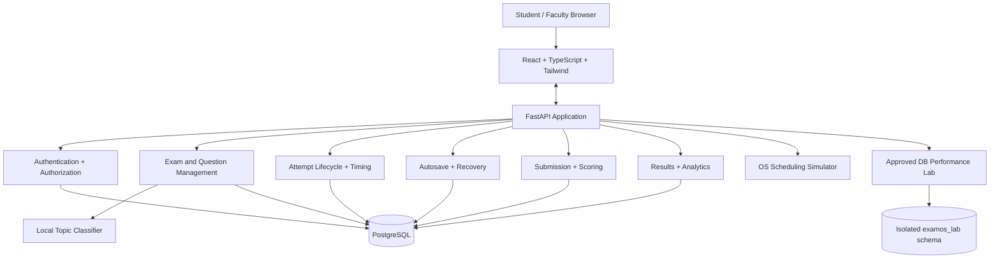
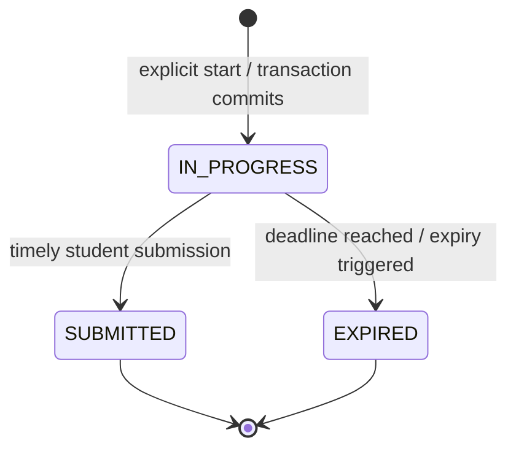
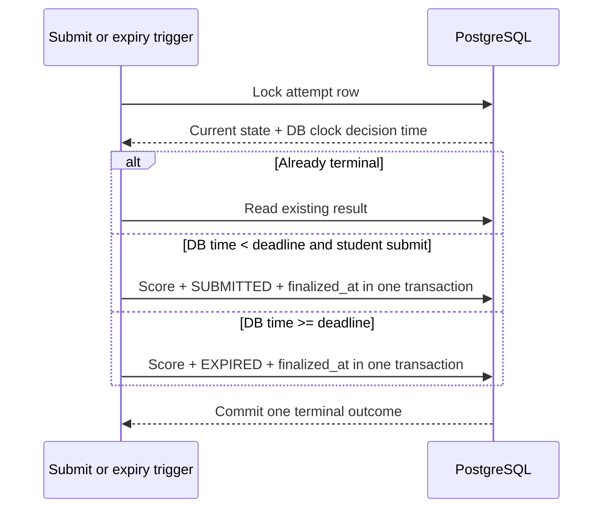
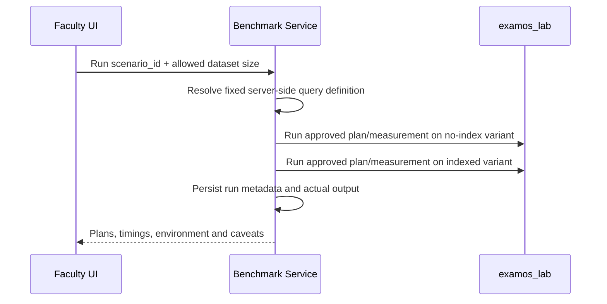

# ExamOS — System Architecture

**Version:** 0.2  
**Status:** Draft — System Architecture  
**Source of truth:** `00_PROJECT_BRIEF.md`, `01_REQUIREMENTS.md` including Appendix A  
**Architecture style:** Modular monolith with a separate browser frontend

## 1. Purpose and goals

This document turns ExamOS requirements into a buildable system design. It prioritizes correctness, visible OS/DBMS learning outcomes, security, and a realistic solo-development path.

Architecture goals:

1. Deliver one working end-to-end examination workflow early.
2. Make PostgreSQL authoritative for answers, deadlines, attempt state, and final results.
3. Make saves recoverable and safe under retries and multiple tabs.
4. Make finalization atomic and idempotent.
5. Keep the OS simulator independent of live exam state.
6. Keep the benchmark lab restricted to approved queries and isolated data.
7. Keep ML local, optional, and non-blocking.
8. Avoid infrastructure whose operational cost exceeds its value for a 2–4 week project.

## 2. Architecture at a glance



The frontend is a single application with role-aware route groups. The backend is one FastAPI process organized into modules and service boundaries. PostgreSQL is the only required stateful infrastructure. ML model files are local build/runtime artifacts, not a separate service.

## 3. Technology decisions

| Layer | Decision | Reason / trade-off |
|---|---|---|
| Frontend | React + TypeScript + Vite + Tailwind CSS | Fast iteration and type checking with a clean component model. |
| Routing | React Router or equivalent lightweight router | Explicit student/faculty route boundaries. |
| HTTP client | Small typed `fetch` wrapper | Avoid hidden network behavior and make auth/error handling explicit. A query-cache library is optional, not required. |
| Backend | FastAPI + Pydantic | Python aligns with the ML module and FastAPI provides request validation/OpenAPI. |
| Database access | SQLAlchemy 2.x with synchronous sessions initially | Simpler transaction boundaries for this size; sync endpoints run through FastAPI's worker thread behavior. No need to add async DB complexity. |
| Database | PostgreSQL | Strong constraints, transactions, row locks, `EXPLAIN ANALYZE`, and the performance lab. |
| Migrations | Alembic | Versioned schema changes and repeatable setup. |
| Authentication | Short-lived signed JWT in HttpOnly cookie, role checked server-side | Browser refresh works without JS reading the token. Use strict CORS allowlist and CSRF token on state-changing requests. |
| Password hashing | Established password-hashing library using a modern adaptive hash | Never store plaintext or reversible passwords. Use the library's current recommended configuration. |
| Charts | Recharts or a small chart component | Useful for simulator Gantt/results and analytics. |
| ML | scikit-learn TF-IDF + Logistic Regression | Lightweight, local, reproducible and explainable enough for a PBL demo. |
| Tests | Pytest; frontend unit tests as time permits | Prioritize backend correctness and end-to-end manual scenarios. |
| Local orchestration | Docker Compose optional | Reproducible PostgreSQL/backend environment without requiring cloud deployment. |

Pin the actual installed dependencies in the project's lock/requirements files during setup. Do not hard-code future version guesses into this architecture.

## 4. Backend module boundaries

```text
backend/app/
├── main.py                 # app construction, middleware, router registration
├── core/                   # settings, security helpers, errors, dependencies
├── db/                     # SQLAlchemy engine/session and base metadata
├── models/                 # ORM persistence models
├── schemas/                # Pydantic request/response DTOs
├── api/v1/                 # HTTP routes only; thin adapters
├── services/
│   ├── auth_service.py
│   ├── exam_service.py
│   ├── question_service.py
│   ├── attempt_service.py
│   ├── answer_service.py
│   ├── finalization_service.py
│   ├── analytics_service.py
│   ├── os_scheduler_service.py
│   ├── benchmark_service.py
│   └── topic_classifier_service.py
├── domain/                 # pure scoring, scheduling and analytics functions
├── ml/                     # safe loader/interface to local model artifact
└── tests/
```

**Dependency direction:** HTTP routers call services; services apply business rules and use persistence; pure domain functions do not import FastAPI or SQLAlchemy. Models and schemas are not interchangeable: never return ORM objects directly as unrestricted API payloads. The classifier is called behind a service interface that has a safe unavailable/fallback result.

A modular monolith means modules are logically separate but deploy together. No internal HTTP calls between modules are needed.

## 5. Frontend organization

Suggested layout:

```text
frontend/src/
├── app/                    # router, app shell, auth context
├── api/                    # typed client, error decoding
├── components/             # shared buttons, notices, loading/error states
├── features/
│   ├── auth/
│   ├── student-exams/
│   ├── attempt/
│   ├── results/
│   ├── faculty-exams/
│   ├── question-bank/
│   ├── analytics/
│   ├── os-simulator/
│   └── db-lab/
└── styles/
```

Do not build a complex frontend state framework preemptively. The current user, route state, and active attempt state can use React context/hooks and local feature state. The server is authoritative for saved answers, remaining time, state, and score.

The attempt UI should track each mutation through `pending`, `saved`, or `failed` states. A countdown is a visual approximation refreshed from server responses; it must never decide if a save or submission is valid.

## 6. Authentication and authorization

### 6.1 Account provisioning

- Public registration creates `STUDENT` accounts only.
- The first `FACULTY_ADMIN` account is created through an operator-controlled seed/bootstrap command. The command must fail safely if required credentials are missing and must not use a published default password.
- Exactly two roles exist in v1: `STUDENT` and `FACULTY_ADMIN`.

### 6.2 Browser authentication

Use an HttpOnly JWT cookie with a configurable, bounded lifetime suitable for a demo examination session (initial default may be eight hours). Configure `SameSite=Lax`, use `Secure` in HTTPS deployments, and restrict CORS to the configured frontend origin. State-changing cookie-authenticated requests must present and validate a CSRF token. The JWT contains only identity and role claims needed by the backend, with expiration and issued-at claims; do not put personal data or secrets in it.

Logout clears the browser cookie. Server-side token revocation is not required for v1; document that an already-issued token remains valid until expiry if copied elsewhere. Never store signing secrets in source control.

### 6.3 Enforcement

Authentication proves identity; service-level authorization checks resource ownership and role for each protected operation. Hiding a button in React is not security. Students can only access their own attempts/results/analytics. Faculty can manage all exams and view finalized attempts in the prototype. Correct answers are excluded from student payloads while attempts are active.

## 7. Attempt lifecycle

Appendix A resolves OD-10: do not persist `CREATED`. Creating an attempt and starting its timer happen in one database transaction when a student explicitly starts a published exam.



| Transition | Preconditions | Durable effects |
|---|---|---|
| no attempt → `IN_PROGRESS` | Authenticated student; exam published; no previous attempt for student/exam | Insert attempt, freeze `started_at`, `deadline_at`; initialize answer rows; commit together. |
| `IN_PROGRESS` → `SUBMITTED` | The DB-time decision point is strictly before `deadline_at`; attempt is still active | Score from persisted answers; persist `SUBMITTED`, `finalized_at`, and score in one transaction. |
| `IN_PROGRESS` → `EXPIRED` | DB-time decision point is at or after deadline | Score from persisted answers; persist `EXPIRED`, `finalized_at`, and score in one transaction. |
| Terminal state → any other state | Never valid | Return the existing terminal result for repeated submit/result calls, or reject mutation. |

The unique `(student_id, exam_id)` constraint prevents retakes and concurrent duplicate starts. A start retry checks for and returns the existing attempt; it must not create a second attempt or reset timing.

Connectivity and recovery are not durable states. A disconnect does not pause the deadline. `last_seen_at`, if included, is optional activity metadata only.

## 8. Authoritative timing and expiry

Use PostgreSQL time as the decision authority. During a save or finalization transaction:

1. Select the attempt row `FOR UPDATE`.
2. Obtain `clock_timestamp()` **after** the row lock is acquired.
3. Compare that decision time to the persisted deadline.
4. Accept the save/submission only if decision time is strictly less than the deadline. At or after the deadline, expire/finalize instead.
5. Commit all related changes together.

This exclusive cutoff rule is the same for saving and student submission. This avoids mixing application-server clock and database clock decisions.

**Lazy finalization:** any relevant service that returns attempt state or includes attempts in results/analytics must run an expiry check first. If the attempt is overdue, the service calls the same finalization function while holding the appropriate lock and returns `EXPIRED`, not an active attempt. Analytics either finalize overdue attempts in their scope or exclude them, as required by the SRS. The optional in-process sweep uses the same finalization service. A restart may stop the sweep; lazy finalization still preserves correctness.

Do not claim that an abandoned attempt is finalized at the exact deadline in storage without an active trigger. Its time validity changes at the deadline; its stored terminal state is materialized on the next relevant access or sweep.

## 9. Autosave, revisions and recovery

### 9.1 Answer model

Each attempt has one answer record for every frozen exam question. Unanswered records have `selected_option_id = NULL`, `marked_for_review = false`, `revision = 0`. Every accepted mutation increments the answer revision.

### 9.2 Update protocol

Each answer/review mutation carries:

- `expected_revision`: the revision the tab last read.
- `mutation_id`: unique ID generated for that logical mutation.
- the desired selected option and review flag.

Inside one transaction the service locks/updates the answer record while also serializing against finalization via the attempt row. It validates ownership, active state, deadline, question membership, and option membership. If `expected_revision` matches, apply and increment revision. If it does not match, do not overwrite: return a conflict with the latest canonical answer/revision. If a retry has the same `mutation_id` and the exact mutation is already reflected, return the stored current state as an idempotent success rather than apply twice. Keep idempotency implementation small; do not introduce a distributed cache.

**Lock ordering:** obtain the attempt lock first, then the answer row, for all save and finalization paths to reduce deadlocks and make the serialization rule explicit.

### 9.3 Frontend behavior

Debounce edits by about 300 ms per question. Do not debounce so long that navigating or submitting loses current work: flush pending mutations before leaving the question when practical and before submit. Retry transient failures with bounded backoff. After bounded failures, show `Failed to save — retry` and preserve the local pending edit. A failed or pending edit is never labelled saved. On a revision conflict, reload server state and show a clear conflict message instead of silently overwriting.

### 9.4 Recovery

The server returns the persisted answers, review flags, per-answer revisions, and remaining time derived from `deadline_at`. A local unsent edit may be shown as pending only while it is still available in the current browser memory; after a full refresh, persisted server state is the truth unless a separately specified local draft mechanism is added. Do not silently replay stale local values over server data.

## 10. Finalization and transaction semantics

Use a single finalization service callable by student submission, lazy expiry, and the optional sweep. A typical transaction:

1. Lock attempt row.
2. If terminal already, return persisted outcome unchanged.
3. Read DB time after locking.
4. Determine terminal status from the exclusive deadline rule and trigger type.
5. Read frozen question snapshots and persisted answers.
6. Calculate score in trusted backend/domain code (or a controlled SQL expression) from immutable snapshots.
7. Update attempt status, `finalized_at`, score and any outcome metadata.
8. Commit once.

The score and terminal fields live on the attempt row, so the row update acts as the one persisted result. If a separate results table is later introduced, it must use a one-to-one uniqueness constraint and share the same transaction.

A submit racing with expiry serializes on the attempt row. If a terminal result already exists, every request returns it. If no result exists, the request holding the lock decides using database time: before the deadline a student submit can result in `SUBMITTED`; at/after the deadline it must be `EXPIRED`. An expiry trigger cannot expire a timely attempt before its deadline. Any failure before commit leaves neither partial terminal state nor partial score visible.

Avoid claiming literal exactly-once execution of all code. The guarantee is one committed terminal outcome and idempotent retries.

## 11. Content snapshots and historical integrity

The question bank is an authoring source. When an exam is published, the service creates frozen exam-question and exam-option snapshots including prompt text, topic label, order, marks, options, and correct option. Attempt answers reference the frozen options, not mutable bank options.

After first publication, an exam's assessment definition is immutable even if the exam is subsequently unpublished. Unpublishing prevents new starts and does not invalidate active attempts. To revise content, faculty create a new draft exam and publish it as a separate examination. Editing a bank question affects future snapshots only. This keeps historical score calculation stable without event sourcing or a complex versioning engine.

## 12. Database architecture summary

Core conceptual entities: users, topics, question bank questions/options, exams, published exam-question snapshots/options, attempts, attempt answers, and benchmark run metadata. The performance lab uses an isolated `examos_lab` schema and seeded lab tables. Full columns, constraints, and indexes are specified in `03_DATABASE_DESIGN.md`.

Use SQLAlchemy for normal persistence and Alembic for migrations. Critical updates may use explicit SQL/SQLAlchemy row locks and conditional updates where they make transaction behavior clearer. Do not rely on ORM model validation alone for referential integrity. Enforce ownership and valid option/question relationships in both service validation and appropriate constraints where feasible.

## 13. Database Performance Lab isolation

- Store lab records in `examos_lab`, separate from exam tables.
- Expose only a catalogue of scenario IDs and approved dataset-size choices.
- Query text, table names, sort order and schema names are defined server-side constants, never user-supplied SQL.
- Seed paired logically identical data variants: one without the tested index and one with it. Keep seed and size metadata identical so each comparison is interpretable.
- Execute only approved `SELECT` benchmark statements with `EXPLAIN (ANALYZE, BUFFERS, FORMAT JSON)` or a supported equivalent. Show actual returned plan/measurements, errors, dataset parameters and run time.
- Limit rows and permitted sizes. If timeouts cannot be reliably cancelled in the selected driver, keep datasets and queries small enough for local use and document the limitation.
- The benchmark service must not perform table drops/resets on live exam schema. Lab resets touch only lab objects.

## 14. OS scheduler architecture

The scheduler is a pure domain module over abstract jobs. It does not access attempt records or PostgreSQL. Implement FCFS (non-preemptive), Round Robin, and non-preemptive Priority Scheduling as specified in Appendix A. Return a schedule representation, per-job metrics, aggregate metrics and idle intervals; the UI renders a Gantt-style timeline and comparison view. Use hand-verified test cases as the oracle.

## 15. ML and analytics

The topic classifier loads a local saved scikit-learn pipeline. Its service returns either `{topic, confidence}` or an explicit unavailable/no-suggestion result. It must not throw an error that blocks question management. Training/evaluation is a reproducible offline command, not a production endpoint. Store faculty's submitted topic, not model predictions, as the question's actual topic.

Analytics are separate deterministic functions over finalized attempts. Use frozen topic labels from the exam snapshot. Show counts with percentages. Rank only topics with at least three questions in the attempt; otherwise label as a small sample. For ties, show multiple topics rather than manufacture a unique ranking.

## 16. Main request flows

### Start and resume

```mermaid
sequenceDiagram
    participant S as Student UI
    participant API as FastAPI
    participant DB as PostgreSQL
    S->>API: Start exam
    API->>DB: Verify published exam; lock/check unique student+exam
    API->>DB: Insert IN_PROGRESS attempt + deadline + answer rows
    DB-->>API: Commit or existing attempt
    API-->>S: Attempt snapshot, answers, remaining time
```

### Autosave

```mermaid
sequenceDiagram
    participant UI as React Attempt UI
    participant API as Answer Service
    participant DB as PostgreSQL
    UI->>API: Save answer + expected_revision + mutation_id
    API->>DB: Lock attempt, check deadline/state, lock answer
    API->>DB: Compare revision; update answer and increment revision
    DB-->>API: Commit
    API-->>UI: Acknowledgement + canonical answer/revision
    Note over UI,API: On stale revision: 409 with latest state; never silently overwrite
```

### Submission / expiry race



### Approved DB benchmark



## 17. Repository layout

```text
exam-os/
├── AGENTS.md
├── README.md
├── docs/
├── frontend/
│   ├── src/app/
│   ├── src/api/
│   ├── src/components/
│   └── src/features/{auth,attempt,faculty,results,os-simulator,db-lab}/
├── backend/
│   ├── app/{api,core,db,domain,models,schemas,services}/
│   ├── alembic/
│   ├── tests/
│   └── pyproject.toml or requirements files
├── database/
│   ├── seeds/
│   └── benchmarks/
├── ml/
│   ├── data/question_topics.csv
│   ├── train.py
│   ├── evaluate.py
│   └── artifacts/            # generated model; do not commit secrets
├── docker-compose.yml
└── .env.example
```

Keep the repository small. Do not create a package for every file or a deployment unit for each module.

## 18. Deployment and local development

The supported baseline is local development: frontend dev server, FastAPI server, and one PostgreSQL instance. The frontend calls the backend over an explicitly configured origin. CORS allows only that origin with credentials as required by cookie authentication. Migrations run before seeding demo data. The seed process creates a faculty account from operator-provided environment variables and optionally a small demo exam.

Use `.env.example` with placeholders only. Required settings should include database URL, JWT signing secret, allowed frontend origin, cookie security settings, token lifetime, maximum exam duration/question/job/dataset sizes, ML artifact path, classifier threshold, and optional sweep interval. Validate settings at startup and fail with a clear message if required configuration is absent.

Docker Compose is helpful but not a requirement for project correctness. No cloud deployment is needed to pass the project's completion criteria.

## 19. Architecture decisions

| ADR | Decision | Rationale | Trade-off / rejected alternative |
|---|---|---|---|
| ADR-01 | Modular monolith | One student can build, test and demo it within weeks. | Fewer independent scaling options than microservices; acceptable for PBL. |
| ADR-02 | PostgreSQL is authoritative | Transactions, row locks, constraints and query plans are central learning outcomes. | Requires a real PostgreSQL instance for realistic tests; do not substitute SQLite for critical transaction tests. |
| ADR-03 | Persist DB-generated deadline | Avoid client-clock drift and refresh-based time extension. | A stored overdue attempt is materialized as terminal on access/sweep, not at a guaranteed exact instant. |
| ADR-04 | Attempt lock + answer revision | Serializes saves against finalization and prevents stale overwrites. | Conflicts require a visible reload path. |
| ADR-05 | Atomic idempotent finalization | One terminal outcome and a stable score. | Lock contention is possible for the same attempt, but this is low-volume and correct. |
| ADR-06 | Snapshot exam content at publication | Historical results survive question-bank edits. | Revising a published exam means creating a new exam. |
| ADR-07 | Isolated approved DB lab | Demonstrates real PostgreSQL behavior without arbitrary SQL exposure. | More seed data and paired variants are needed. |
| ADR-08 | Local optional ML pipeline | No external dependency; core app still works. | Small dataset may produce weak suggestions. |
| ADR-09 | Cookie JWT with CSRF protection | Browser persistence without exposing token to JavaScript. | Requires careful CORS, CSRF and cookie configuration. |

## 20. Requirement traceability and change register

| Area | Main requirements | Resolution / notes |
|---|---|---|
| Account provisioning | FR-AUTH-004–010, OD-01 | Students self-register; faculty account via trusted seed/bootstrap command. |
| Availability and retakes | FR-EXAM-005–007, FR-ATTEMPT-004–005, OD-02/03 | Published exams visible to all students; one attempt ever per student/exam. |
| Lifecycle | FR-ATTEMPT-001–010, OD-10 | Normative amendment: only `IN_PROGRESS`, `SUBMITTED`, `EXPIRED`; start creates `IN_PROGRESS`. See Appendix A. |
| Deadline/finalization | FR-TIME-001–005, FR-SUBMIT-001–009, FR-EXPIRE-001–006 | Exclusive cutoff `decision_time < deadline_at`; row lock and DB clock. |
| Content immutability | FR-EXAM-003/006/008, FR-QUESTION-004/009, OD-08 | Frozen snapshot at publication; new draft for revisions. |
| Save ordering | FR-SAVE-001–010, OD-07 | Expected revision + mutation ID; lock attempt before answer. |
| Scheduler | FR-OSLAB-003–016, OD-05 | Non-preemptive priority; lower numeric value is higher; deterministic ties. |
| ML | FR-ML-001–011, OD-06 | Eight-class fixed taxonomy; target >=20 labelled examples/topic, stratified split, no claimed accuracy. |
| Analytics | FR-ANALYTICS-001–009, OD-12 | Three questions/topic minimum for ranking; all ties shown. |
| Provisional performance | NFR-PERF-001–005, OD-11 | Measure on documented local environment; no assumed results. |

### Requirements changes needed in the baseline SRS

1. Amend the attempt-state requirements to remove persisted `CREATED`; create `IN_PROGRESS` atomically at explicit start.
2. Tighten the retake rule to one attempt ever per student/exam.
3. Explicitly freeze assessment content at publication and require a new exam for changes.
4. Apply the exclusive database-time deadline boundary from Appendix A to both saves and submission.
5. Resolve account provisioning, result disclosure, scheduling conventions, autosave policy, taxonomy, and analytics sample threshold per Appendix A.

These changes are already recorded in `01_REQUIREMENTS.md` Appendix A; do not implement conflicting interim text.

## 21. Next document

`03_DATABASE_DESIGN.md` defines the ER model, table/column data dictionary, constraints, indexes, migration order, critical transactions and benchmark schema.

**Document Status:** Draft — System Architecture
