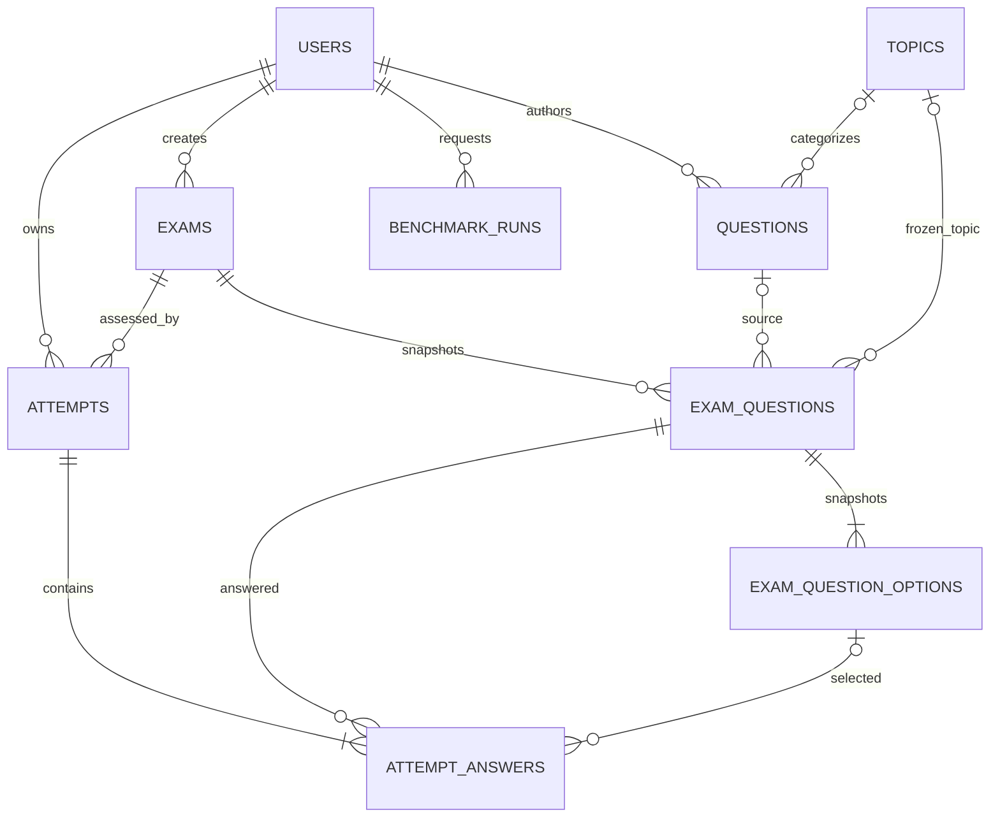

# ExamOS — Database Design

**Version:** 0.2 · **Status:** Draft — Database Design  
**Target:** PostgreSQL; SQLAlchemy 2.x; Alembic migrations  
**Related:** `01_REQUIREMENTS.md` Appendix A, `02_SYSTEM_ARCHITECTURE.md`

## 1. Goals

The schema must preserve exam content used for grading, support transactional attempts, prevent cross-student access at the service layer, make stale saves detectable, and demonstrate normalization, constraints, indexes, transactions and query plans.

Use UUID primary keys for application entities. Use PostgreSQL `timestamptz` for time values and UTC at the application boundary. Store monetary values nowhere; scores/marks use a consistent numeric representation. Avoid storing computed analytics unless measurement shows a clear need.

## 2. ER diagram

The exam-question and option tables hold a **published content snapshot**. Attempts and answers reference those snapshots, not mutable authoring options. A finalized result is stored on its attempt row, avoiding an unnecessary separate results table for v1.

## 3. Table definitions

The following is the intended logical schema. Exact SQLAlchemy names/types may be adjusted to framework conventions, but constraints and behavior must remain equivalent.

### 3.1 `users`

| Column | Type / rule | Purpose |
|---|---|---|
| `id` | UUID PK | User identity. |
| `email` | `varchar`, NOT NULL, UNIQUE, normalized lower-case | Login identifier. |
| `display_name` | `varchar`, NOT NULL | UI name. |
| `password_hash` | `varchar`, NOT NULL | Adaptive password hash only. |
| `role` | enum/check: `STUDENT`, `FACULTY_ADMIN` | Authorization role. |
| `is_active` | boolean NOT NULL default true | Account disable switch. |
| `created_at` | `timestamptz` NOT NULL | Audit metadata. |
| `updated_at` | `timestamptz` NOT NULL | Audit metadata. |

**Rules:** public registration inserts `STUDENT` only. A trusted seed/bootstrap operation may insert `FACULTY_ADMIN`. The API never accepts role elevation from public input.

### 3.2 `topics`

| Column | Type / rule | Purpose |
|---|---|---|
| `id` | UUID PK | Topic identity. |
| `code` | `varchar` UNIQUE NOT NULL | Stable taxonomy key. |
| `name` | `varchar` UNIQUE NOT NULL | Display label. |
| `subject` | check: `OS` or `DBMS` | Topic grouping. |
| `is_active` | boolean NOT NULL | Whether available for new questions. |

Seed these eight taxonomy topics: Process Management; CPU Scheduling; Synchronization and Deadlocks; Memory and File Systems; Relational Modeling and Normalization; SQL Queries and Joins; Transactions and Concurrency; Indexing and Query Optimization.

### 3.3 `questions` (authoring bank)

| Column | Type / rule | Purpose |
|---|---|---|
| `id` | UUID PK | Question identity. |
| `author_id` | FK → `users.id`, NOT NULL | Faculty author. |
| `topic_id` | nullable FK → `topics.id` | Faculty-confirmed topic. |
| `prompt` | text NOT NULL, non-empty after trim | Question text. |
| `archived_at` | nullable `timestamptz` | Soft archive rather than hard-delete used questions. |
| `created_at`, `updated_at` | `timestamptz` NOT NULL | Audit. |

Only plain-text, single-correct MCQs are in v1. Editing the authoring bank never alters already-published snapshots.

### 3.4 `question_options` (authoring bank)

| Column | Type / rule | Purpose |
|---|---|---|
| `id` | UUID PK | Option identity. |
| `question_id` | FK → `questions.id`, ON DELETE RESTRICT | Parent question. |
| `option_text` | text NOT NULL, non-empty | Option. |
| `display_order` | integer NOT NULL, >= 1 | Stable authoring order. |
| `is_correct` | boolean NOT NULL | Exactly one correct option per question, enforced by a deferred/transactional service check or a suitable partial unique index. |

Constraints: `UNIQUE(question_id, display_order)`. PostgreSQL partial unique index on `(question_id) WHERE is_correct` ensures **at most one** correct option; service-level publish validation ensures **at least one**. Alternatively, validate both under a transaction at publish. Do not rely on UI validation.

### 3.5 `exams`

| Column | Type / rule | Purpose |
|---|---|---|
| `id` | UUID PK | Exam identity. |
| `creator_id` | FK → `users.id`, NOT NULL | User who created it; informational in single-admin scope. |
| `title` | varchar NOT NULL | Exam title. |
| `instructions` | text NOT NULL default empty | Instructions. |
| `duration_minutes` | integer NOT NULL, >0 and <= configured maximum | Duration. |
| `status` | check: `DRAFT`, `PUBLISHED`, `UNPUBLISHED` | Publication lifecycle. |
| `published_at` | nullable `timestamptz` | First publication time. |
| `created_at`, `updated_at` | `timestamptz` NOT NULL | Audit. |

A published exam's assessment definition is immutable. `UNPUBLISHED` blocks new attempts but does not affect already-started attempts. Revisions are new exam rows created as drafts.

### 3.6 `exam_questions` (frozen published snapshot)

| Column | Type / rule | Purpose |
|---|---|---|
| `id` | UUID PK | Snapshot question identity. |
| `exam_id` | FK → `exams.id`, ON DELETE RESTRICT | Parent exam. |
| `source_question_id` | nullable FK → `questions.id`, ON DELETE RESTRICT | Provenance to authoring question; archive source questions instead of deleting them. |
| `prompt_snapshot` | text NOT NULL | Frozen question text. |
| `topic_code_snapshot` | nullable varchar | Frozen topic key/display basis for analytics. |
| `topic_name_snapshot` | nullable varchar | Frozen label shown in historic results. |
| `marks` | numeric/decimal NOT NULL, > 0 | Score value for this exam. |
| `display_order` | integer NOT NULL, >= 1 | Display order. |

Constraints: `UNIQUE(exam_id, display_order)` and `UNIQUE(id, exam_id)` for composite foreign keys. In a publish transaction, copy bank question/options to these snapshot tables and change exam status only if all checks pass.

### 3.7 `exam_question_options` (frozen options)

| Column | Type / rule | Purpose |
|---|---|---|
| `id` | UUID PK | Snapshot option identity. |
| `exam_question_id` | FK → `exam_questions.id`, ON DELETE RESTRICT | Parent snapshot question. |
| `option_text_snapshot` | text NOT NULL | Frozen display text. |
| `display_order` | integer NOT NULL, >= 1 | Option order. |
| `is_correct` | boolean NOT NULL | Server-side grading only. Never serialize this field into an in-progress student payload. |

Constraints: `UNIQUE(exam_question_id, display_order)`, `UNIQUE(exam_question_id, id)`, and at most one correct option via partial unique index on `exam_question_id WHERE is_correct`. Publication validation checks option count and exactly one correct option.

### 3.8 `attempts`

| Column | Type / rule | Purpose |
|---|---|---|
| `id` | UUID PK | Attempt identity. |
| `student_id` | FK → `users.id`, NOT NULL | Owner; role must be STUDENT at creation. |
| `exam_id` | FK → `exams.id`, NOT NULL | Exam being attempted. |
| `status` | check: `IN_PROGRESS`, `SUBMITTED`, `EXPIRED` | Durable state. There is no persisted `CREATED` state. |
| `started_at` | `timestamptz` NOT NULL | Start time assigned by server/database. |
| `deadline_at` | `timestamptz` NOT NULL | Persisted `started_at + duration`. |
| `finalized_at` | nullable `timestamptz` | Time result was committed. |
| `score` | nullable numeric, >=0 | NULL while active; required for terminal outcomes. |
| `last_seen_at` | nullable `timestamptz` | Optional activity metadata, not lifecycle state. |
| `created_at` | `timestamptz` NOT NULL | Audit. |

Constraints:
- `UNIQUE(student_id, exam_id)` to enforce no retake in v1.
- `UNIQUE(id, exam_id)` for composite consistency checks.
- `CHECK(deadline_at > started_at)`.
- Active status requires `finalized_at IS NULL AND score IS NULL`; terminal status requires `finalized_at IS NOT NULL AND score IS NOT NULL`.
- Optional trigger/check logic may enforce these paired nullability conditions if the status-specific `CHECK` becomes verbose.

No client-provided timestamp, score, or status is persisted as authoritative.

### 3.9 `attempt_answers`

| Column | Type / rule | Purpose |
|---|---|---|
| `id` | UUID PK | Answer row identity. |
| `attempt_id` | NOT NULL | Parent attempt. |
| `exam_id` | NOT NULL | Redundant key used to enforce same-exam relationships. |
| `exam_question_id` | NOT NULL | Frozen question. |
| `selected_option_id` | nullable | Frozen option selected; NULL means unanswered. |
| `marked_for_review` | boolean NOT NULL default false | Review flag. |
| `revision` | integer NOT NULL default 0, >=0 | Optimistic concurrency version. |
| `updated_at` | `timestamptz` NOT NULL | Last accepted mutation. |

Constraints:
- `UNIQUE(attempt_id, exam_question_id)`.
- Composite FK `(attempt_id, exam_id)` → `attempts(id, exam_id)`.
- Composite FK `(exam_question_id, exam_id)` → `exam_questions(id, exam_id)`.
- Composite FK `(exam_question_id, selected_option_id)` → `exam_question_options(exam_question_id, id)`; because option is nullable, unanswered rows remain valid.
- Insert all answer rows with `revision=0`, no selected option, and `marked_for_review=false` in the transaction that starts the attempt.

The service locks the attempt row first and answer row second. A successful mutation increments `revision`. A stale revision returns a conflict and canonical server state; never overwrite silently.

### 3.10 `benchmark_runs`

| Column | Type / rule | Purpose |
|---|---|---|
| `id` | UUID PK | Benchmark run. |
| `requested_by` | FK → `users.id`, NOT NULL | Faculty user. |
| `scenario_code` | varchar NOT NULL | Server-approved catalogue key. |
| `dataset_size` | integer NOT NULL | Selected approved size. |
| `seed` | integer NOT NULL | Reproducibility. |
| `variant` | check: `NO_INDEX`, `INDEXED`, `COMPARISON` | Variant represented. |
| `postgres_version` | varchar NOT NULL | Environment metadata. |
| `run_metadata` | JSONB NOT NULL | Repetitions, elapsed values, timing summary calculation, configuration. |
| `plan_output` | JSONB nullable | Actual JSON plan output; limit stored size. |
| `status` | check: `SUCCEEDED`, `FAILED`, `TIMED_OUT` | Execution outcome. |
| `error_summary` | text nullable | Sanitized failure reason. |
| `created_at` | `timestamptz` NOT NULL | Run time. |

Do not store arbitrary SQL text submitted by a user. The scenario code maps to an allow-listed query implementation. If query text is stored for diagnostics, it must be a server-owned fixed template without secrets or user-submitted SQL.

## 4. Constraints and integrity rules

1. Use database primary keys, foreign keys, unique constraints, `NOT NULL`, checks and indexes in addition to service validation.
2. Every user-facing request must confirm role and resource ownership before returning data.
3. A student attempt can reference only the exam the student is attempting, and an answer can reference only a question and option from that frozen exam.
4. Publish is one transaction: validate exam, questions, options, correct answers, duration and marks; snapshot all content; set status `PUBLISHED`; commit. If any step fails, publish nothing.
5. Score is calculated only from `attempt_answers` and frozen `exam_question_options.is_correct` values at finalization.
6. A published exam and its snapshot children are immutable via application service rules. The DB account should not be used for ad hoc edits.
7. Deleting records that participate in attempts is restricted; archive authoring questions instead of deleting history.

## 5. Index strategy

Add indexes for expected lookup paths; verify with actual query plans rather than indexing every column.

| Index | Reason |
|---|---|
| unique `users(email)` | Login lookup. |
| `questions(topic_id, archived_at)` | Faculty question-bank filters. |
| `exams(status, created_at)` | Published exam list and faculty list. |
| unique `exam_questions(exam_id, display_order)` | Ordered question retrieval and duplicate-order prevention. |
| unique `attempts(student_id, exam_id)` | Enforces one attempt per student/exam. |
| `attempts(exam_id, status, started_at)` | Faculty attempt list and overdue-attempt scans. |
| partial index on `attempts(deadline_at) WHERE status='IN_PROGRESS'` | Sweep/lazy expiry candidate lookup. |
| unique `attempt_answers(attempt_id, exam_question_id)` | Fetch one answer per question/attempt. |
| `attempt_answers(exam_id, exam_question_id)` if verified useful | Cross-attempt answer analytics; keep only if query plans justify it. |
| `benchmark_runs(created_at DESC)` | Recent lab run history. |

The Database Performance Lab uses isolated schema objects with intentional indexed/non-indexed variants; those benchmark objects should not be confused with the application's operational indexes.

## 6. Critical transaction designs

### 6.1 Start attempt

In one transaction: validate authenticated student and published exam; check for an existing attempt; insert `IN_PROGRESS` with database-generated `started_at` and computed `deadline_at`; insert one unanswered row per frozen exam question; commit. The unique `(student_id, exam_id)` constraint settles simultaneous starts. If a concurrent insert wins, retrieve and return the existing attempt without resetting its deadline.

### 6.2 Save answer/review flag

In one transaction: lock attempt row; obtain database time after lock; finalize as expired first if `clock_timestamp() >= deadline_at`; reject if terminal/expired/not owner; validate question and option; lock answer row; compare expected revision; return conflict on stale request; otherwise apply selected option and review flag, increment revision, commit. Repeated mutation IDs should be idempotent. The same lock order must be used by all paths.

### 6.3 Finalize

Lock attempt row; if terminal return existing outcome. Get database decision time after lock. If the trigger is student submission and time is strictly before deadline, use `SUBMITTED`; if at/after deadline use `EXPIRED`. An expiry trigger can finalize only at/after deadline. Calculate score from frozen content and persisted answer rows. Update status, score and finalized time atomically, then commit.

### 6.4 Publish exam

Validate draft and create immutable content snapshots in a single transaction. The snapshot contains question prompt, frozen topic, ordered option text, correct option, marks and question order. Only after all snapshots pass validation does the exam become published.

## 7. Database Performance Lab schema isolation

Use `examos_lab` for generated data and paired variants. Provide fixed-size options such as small/medium/large configured row counts (exact values in the benchmark specification after local validation). Store scenario code and metadata, never arbitrary UI SQL. A safe option is to seed paired logically identical tables (with-index and without-index) so runtime execution is limited to SELECT/EXPLAIN operations and does not require schema DDL privileges. The pair must be generated with the same seed and have equal row counts/content checksums. If runtime index creation/removal is chosen instead, constrain it to lab objects and document permissions carefully.

For each approved scenario, run several repetitions; report every actual measurement and a clearly defined summary (median is recommended). Use `EXPLAIN (ANALYZE, BUFFERS, FORMAT JSON)` for fixed read-only queries where appropriate. Plans can differ naturally; an index is not guaranteed to be chosen or improve runtime.

## 8. Migration and seed order

Recommended migration sequence:

1. `users`, role type/checks.
2. `topics` and seed taxonomy.
3. `questions`, `question_options`.
4. `exams`.
5. `exam_questions`, `exam_question_options`.
6. `attempts` and its indexes/checks.
7. `attempt_answers` and composite constraints.
8. `benchmark_runs` and `examos_lab` objects/index variants.

Seed commands should create the faculty user from environment-provided credentials, topic taxonomy, optional student demo accounts, a sample draft exam, and benchmark datasets. Do not store reusable plaintext passwords in repository seed data.

## 9. Open design constraints

- The exact configured maximums for exam duration, question count, option count, scheduler job count and lab dataset size are environment settings to be defined in setup.
- Use numeric marks consistently; choose a scale (for example 2 decimal places) before implementation and validate it across schema, API and score calculation.
- Do not use SQLite as the sole database for transaction/concurrency acceptance tests. PostgreSQL-specific row-lock, constraint and plan behavior must be tested on PostgreSQL.

## 10. Next document

`04_API_CONTRACT.md` specifies endpoint shapes, authorization, request/response payloads, idempotency/revision behavior, errors and payload confidentiality.

**Document Status:** Draft — Database Design
